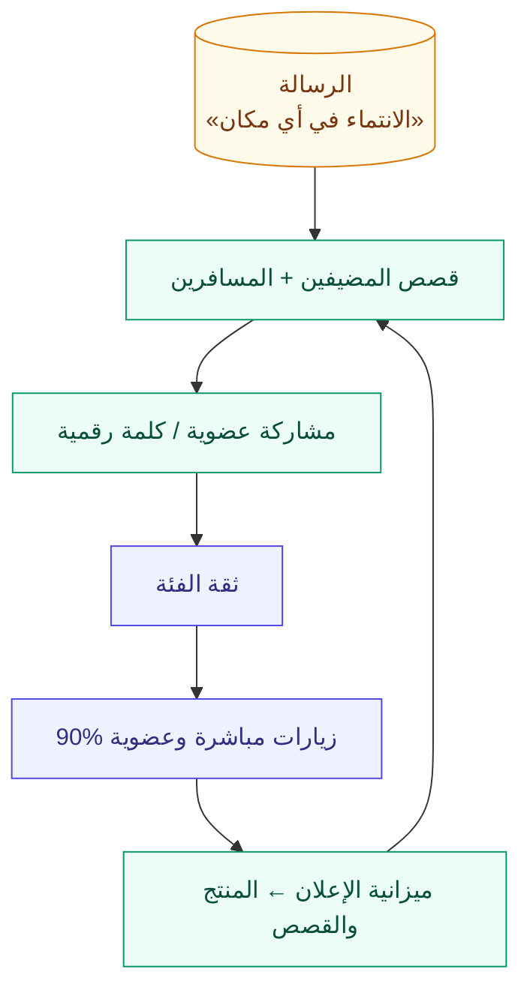
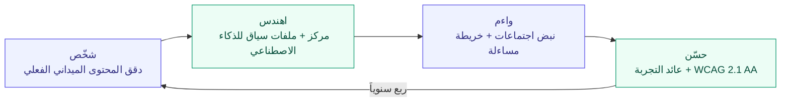

# دراسات حالة في التوسع: كيف تعمل العلامات الأيقونية فعلاً.

*آبل وStripe ونايكي وماكدونالدز وAirbnb — أنظمة التشغيل خلف الشعارات.*

قيمة العلامة التجارية توقفت عن كونها مقياساً ناعماً منذ زمن. إنها قوة تسعير وكفاءة استحواذ وعائد مساهمين يرتدي شعاراً. أثمن علامات الأرض — آبل ونايكي وكوكاكولا وAirbnb — لا تعامل العلامة كتمرين تصميم؛ بل تديرها كنظام تشغيل. ما يلي تشريح للكيفية، حالة بحالة.

- **20–30%** — علاوة آبل السعرية فوق المنافسين
- **52%** — قيمة عمرية أعلى للمرتبطين عاطفياً
- **90%** — زيارات Airbnb مباشرة وعضوية
- **$6M** — كلفة عدم الاتساق سنوياً

## عمالقة التقنية — الدقة كنظام

آبل هي الحالة المرجعية للقيادة التحليلية: تصميم يُقاس بصرامة الإيرادات، ومملوك على مستوى القيادة العليا. الآلية هي تأثير الهالة — الجودة البصرية المدرَكة تتسرب إلى الجودة الوظيفية المدرَكة — والعائد علاوة سعرية 20–30% فوق المنافسين السلعيين، يدفعها عملاء يفاوضون أقل. وStripe تدير نفس الانضباط عبر الهندسة: العلامة كبنية تحتية ناعمة، مصدر حقيقة واحد، وتسليم بمعيار «تعريف الجاهزية» يقطع نصف الوقت بين التصميم والتطوير كي لا يموت إحساس العلامة في الترجمة إلى كود. أما الحضور شبه الطائفي لـ Linear فهو انضباط الامتناع: بديهية حاكمة، ومنطق قرار مشترك، وثقة تقول لا لكل شيء تقريباً.

> القرارات سريعة حين تتشارك الفرق نفس البديهية. طوابير الموافقات هي ما تبنيه الشركات بدلاً من الوضوح.

## أساطير المستهلك — العاطفة والاتساق

نايكي تبيع وعد المثابرة لا الأحذية — والعملاء المرتبطون عاطفياً يعيدون قيمة عمرية أعلى بـ 52% من الراضين فحسب. درس كوكاكولا هو نواة الاتساق: الحملات تتجدد باستمرار، لكن جوهر الهوية (السعادة والاجتماع) لا يتحرك أبداً — لأن عدم الاتساق يكلف المؤسسات الكبيرة ما يفوق ستة ملايين دولار سنوياً. وماكدونالدز تصنّع ذلك الاتساق بحوكمة مدرجة داخل سير عمل الإنشاء نفسه:

| الطبقة | مستوى الخطر | استراتيجية الحوكمة |
| --- | --- | --- |
| الأولى | مرتفع — الشعار العالمي والشعارات الأساسية | عناصر مقفولة وموافقة إلزامية |
| الثانية | متوسط — عروض القوائم الإقليمية | جوهر مقفول وتخصيص ذاتي |
| الثالثة | منخفض — مطبوعات الفعاليات المحلية | قوالب مفتوحة بحواجز دنيا |

## شركات التوسع الحديثة — السردية والمنتج القائد

Airbnb هي دراسة الحالة الحاسمة للتحول من التسويق الأدائي إلى التسويق المقود بالعلامة. عرّفت سبب وجودها (الانتماء في أي مكان)، وبنت دولاب قصص من سرديات المضيفين والمسافرين، وبلغت الحالة التي يحلم بها كل مدير مالي: نحو 90% من الزيارات مباشرة أو عضوية — لم يعد كل عميل يُشترى بإعلان بحث. وحين ضربت الجائحة، سمح لها الوضوح نفسه بقطع مليار دولار تسويق، وإدارة تسريح 25% بشفافية غير مألوفة، والتحول إلى حملة «سافر قريباً» خلال أسابيع. أما Notion وFigma فتثبتان النسخة المقودة بالمنتج: رموز تصميم تمنع الانحراف البصري عند التوسع، وتسمية دلالية تُبقي النظام موثقاً ذاتياً، وحلقات مساهمة تحول المستخدمين إلى شركاء صنع — المناصرة كخاصية معمارية لا كحملة.

*دولاب قصص Airbnb. كل دورة تخفض تكلفة الاستحواذ — منحنى التراكم المعاكس للتسويق المدفوع.*

وتسلا تغلق النمط من طرف الغاية: الحمض النووي (الطاقة المستدامة لا السيارات) يعمل كنجم الشمال، وسردية المؤسس تمنح العلامة عموداً فقرياً إنسانياً، والأهم في فئة جديدة — العلامة ذاتها تخفض خطر الشراء المدرَك لمشترين يدخلون أرضاً غير مألوفة.

## التشريح المقارن

| الشركة | الاستراتيجية الجوهرية | المقياس الأساسي | الرافعة النظامية |
| --- | --- | --- | --- |
| آبل | قيادة تحليلية | الرضا / NPS | تصميم يُقاس كالإيراد |
| نايكي | علامة عاطفية | القيمة العمرية LTV | سردية تقودها الشخصية |
| Airbnb | دولاب سردي | نسبة الزيارات العضوية | سرد قصصي داخلي |
| ماكدونالدز | اتساق نظامي | الالتزام بالمعايير | حوكمة مدرجة |
| Stripe | دقة جراحية | سرعة المطورين | رموز + تسليم بمعيار الجاهزية |

## الخارطة — تثبيت ما ثبّتوه

*خارطة BrandOS ذات المراحل الأربع، مستخلصة من دراسات الحالة أعلاه. وهي تدور — كل علامة في هذا المقال تعاملها كصيانة لا كمشروع.*

1. شخّص: دقق ما تستخدمه الفرق فعلاً في الميدان لا العرض الرئيسي؛ وافحص التآكل البصري والرسائلي.
2. اهندس: مركز أصول الحقيقة الواحدة في مركز موحد؛ واكتب ملفات سياق الذكاء الاصطناعي ليولّد على الهوية افتراضياً.
3. واءم: نبض أسبوعي بمنهجية حدد–ناقش–حُل؛ وخريطة مساءلة بالوظيفة لا باللقب.
4. حسّن: تتبع عائد التجربة والامتثال للوصول — الرافعتان ذواتا أكبر مساحة صعود متاحة.

> علامات المليارات لا تُبنى بالشعارات، بل بالتنفيذ المقود بالنظام — وفي عصر الذكاء الاصطناعي، الأصل الوحيد الذي لا يمكن تحويله لسلعة هو الثقة المكتسبة.
