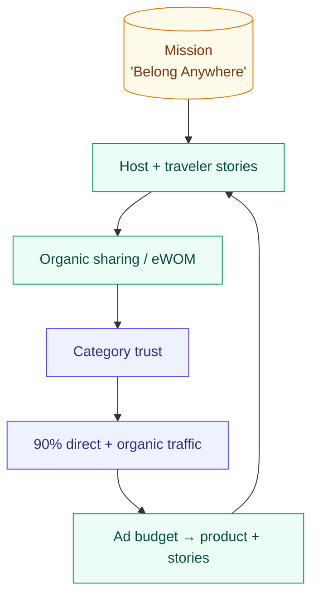
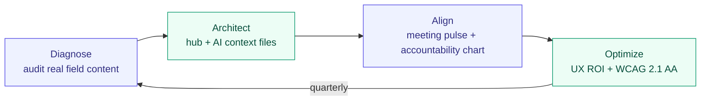

# Case studies in scale: how iconic brands actually run.

*Apple, Stripe, Nike, McDonald's, Airbnb — the operating systems behind the logos.*

Brand value stopped being a soft metric a long time ago. It is pricing power, acquisition efficiency, and shareholder return wearing a logo. The most valuable brands on earth — Apple, Nike, Coca-Cola, Airbnb — don't treat branding as a design exercise; they run it as an operating system. What follows is the anatomy of how, case by case.

- **20–30%** — Apple's price premium over commodity rivals
- **52%** — Higher LTV — emotionally connected customers
- **90%** — Airbnb traffic, direct + organic
- **$6M** — Yearly cost of brand inconsistency

## The tech giants — precision as a system

Apple is the reference case for analytical leadership: design measured with the same rigor as revenue, owned at C-suite level. The mechanism is the halo effect — perceived visual quality bleeding into perceived functional quality — and the payoff is a 20–30% price premium over commodity rivals, paid by customers who negotiate less. Stripe runs the same discipline through engineering: brand as soft infrastructure, one source of truth, and a Definition-of-Ready handoff that cuts design-to-development time by half so the brand feel never dies in translation to code. Linear's cult following is the discipline of restraint — a governing axiom, shared decision logic, and the confidence to say no to almost everything.

> Decisions are fast when teams share the same axiom. Approval queues are what companies build instead of clarity.

## The consumer legends — emotion and consistency

Nike sells the promise of perseverance, not footwear — and emotionally connected customers return a lifetime value 52% higher than merely satisfied ones. Coca-Cola's lesson is the consistency kernel: campaigns refresh constantly, but the identity core (happiness, togetherness) never moves — because inconsistency costs large organizations upward of $6M a year. McDonald's industrializes that consistency with tiered governance embedded in the creation workflow itself:

| Tier | Risk level | Governance strategy |
| --- | --- | --- |
| Tier 1 | High — global logo, core slogans | Locked elements, mandatory approval |
| Tier 2 | Moderate — regional menu promos | Locked core, self-serve personalization |
| Tier 3 | Low — local event flyers | Open templates, minimal guardrails |

## The modern scale-ups — narrative and product-led cults

Airbnb is the definitive pivot from performance marketing to brand-led marketing. It defined its reason for being (Belong Anywhere), built a story flywheel of host and traveler narratives, and reached the state every CFO dreams about: roughly 90% of traffic direct or organic — customers no longer bought one search ad at a time. When COVID hit, the same clarity let it cut $1B in marketing, handle a 25% layoff with unusual transparency, and pivot to "Go Near" within weeks. Notion and Figma prove the product-led variant: design tokens preventing visual drift at scale, semantic naming keeping the system self-documenting, and contribution loops that turn users into co-creators — advocacy as an architectural feature, not a campaign.

*Airbnb's story flywheel. Every turn lowers acquisition cost — the opposite compounding curve of paid marketing.*

Tesla closes the pattern from the purpose end: the DNA (sustainable energy, not cars) acts as the north star, the founder narrative gives the brand a human backbone, and — critically for a new category — the brand itself reduces perceived purchase risk for buyers walking into unfamiliar territory.

## The comparative anatomy

| Company | Core strategy | Primary metric | System lever |
| --- | --- | --- | --- |
| Apple | Analytical leadership | Satisfaction / NPS | Design measured like revenue |
| Nike | Emotional branding | LTV | Character-led narrative |
| Airbnb | Narrative flywheel | % organic traffic | In-house storytelling |
| McDonald's | Systemic consistency | Compliance adherence | Tiered governance |
| Stripe | Surgical precision | Developer velocity | Tokens + DoR handoff |

## The roadmap — installing what they installed

*The four-phase BrandOS roadmap, extracted from the case studies above. It loops — every brand in this article treats it as maintenance, not a project.*

1. Diagnose: audit what teams actually use in the field, not the master deck; scan for visual and messaging erosion.
2. Architect: centralize source-of-truth assets in one hub; write the AI context files so machines generate on-brand by default.
3. Align: weekly pulse with IDS problem-solving; accountability chart by function, not title.
4. Optimize: track UX ROI and accessibility compliance — the two levers with the largest addressable upside.

> Multi-billion dollar brands are not built through logos. They're built through system-driven execution — and in the age of AI, the only asset that can't be commoditized is earned trust.
