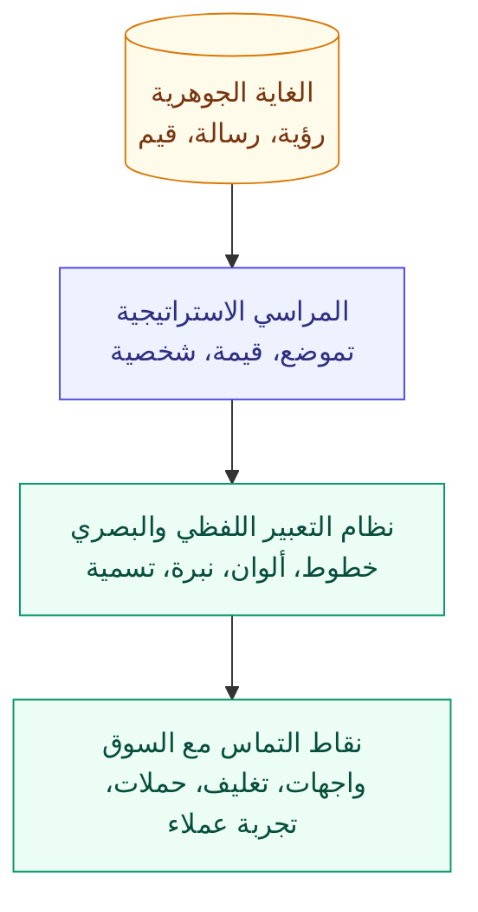
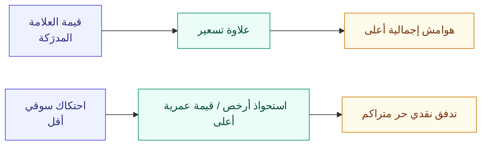
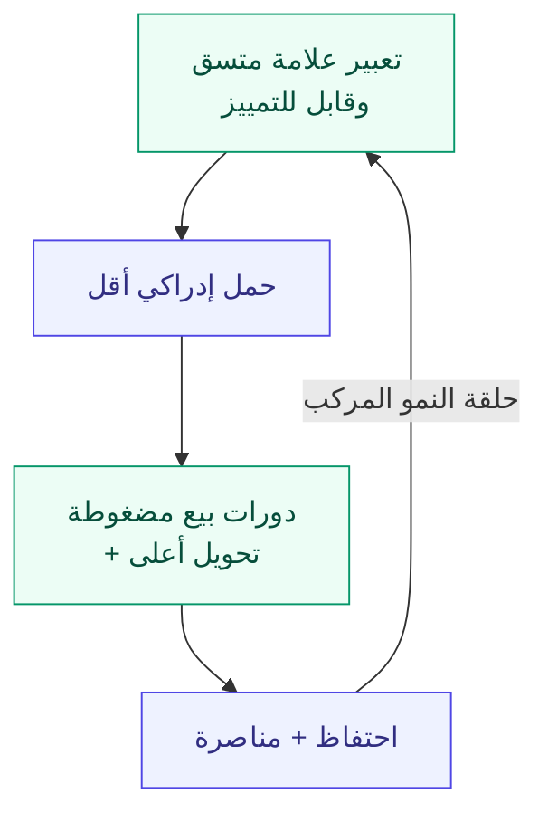

# مخطط الهوية التجارية: من الغاية الجوهرية إلى نقاط التماس مع السوق.

*هرم الطبقات الأربع، القضية المالية، حلقة النمو، ونظام التشغيل الذي يدير كل ذلك.*

الهوية التجارية ليست الطبقة الجمالية للأعمال. إنها الهيكل الإنشائي الذي يوائم ثقافة المؤسسة وهندسة المنتج والتواصل مع السوق — تكوين متعمد للقيم الداخلية والتعبيرات الخارجية. هذا المخطط يرسم الحزمة كاملة: مم تتكون، وكم تساوي مالياً، وكيف تحرك النمو، وكيف تشغّلها الشركات العالمية.

- **4** — طبقات في هرم الهوية
- **1:5** — نسبة CAC:LTV لقادة السوق
- **3–10×** — مضاعف الشهرة عند الاستحواذ
- **3** — نماذج معمارية للمحفظة

## المعمارية ذات الطبقات الأربع

كل هوية معمّرة هي هرم بمصدر حقيقة واحد في قمته. والتغيير يتدفق نزولاً فقط — نقطة التماس لا تعيد أبداً تعريف الغاية:

*هرم الهوية ذو الطبقات الأربع. تكوين هرمي بمصدر حقيقة واحد — صفحة الدفع لا تستطيع مناقضة الرسالة دون أن يلحظ النظام كله.*

| الطبقة | الحتمية الاستراتيجية | المقياس التشغيلي | خطر الفشل |
| --- | --- | --- | --- |
| الأيديولوجية | مواءمة المواهب وخارطة الطريق طويلة المدى | احتفاظ الموظفين وصحة الثقافة | ثقافة مفككة وساخرة |
| الاستراتيجية | اقتطاع مكانة سوقية قابلة للدفاع | الحصة السوقية وعلاوة التسعير | فخ السلعة — منافسة بالسعر وحده |
| التعبيرية | تمييز إدراكي فوري | التذكر ونسب الإسناد | لا تمييز عن المنافسين |
| التفعيلية | رحلة عميل بلا احتكاك | NPS والقيمة العمرية | كسر وعد العلامة عند الدفع |

## قضية الميزانية العمومية — العلامة كأصل مالي

العلامة الفعالة تحوّل القيمة غير الملموسة إلى عوائد ملموسة عبر سلسلتين تنتهيان في التدفق النقدي الحر: القيمة المدرَكة تشتري قوة تسعير توسع الهامش الإجمالي، وانخفاض احتكاك السوق يخفض تكلفة الاستحواذ ويرفع القيمة العمرية.

*السلسلتان الماليتان لقيمة العلامة. كلتاهما تنتهي في النقد — ولهذا مكان العلامة اجتماعات مجلس الإدارة لا مراجعات التسويق فقط.*

| المتجه المالي | كيان سلعي | قائد سوق بعلامة | الأثر |
| --- | --- | --- | --- |
| مرونة التسعير | مرتفعة — التخفيضات تحرك الحجم | منخفضة — الزيادات مقبولة | توسع مباشر للهامش الإجمالي |
| نسبة CAC : LTV | 1:3 أو أسوأ، اعتماد على الإعلان | 1:5 أو أفضل، عضوية الطابع | خفض حاد لتكاليف الاستحواذ |
| استقطاب المواهب | رواتب فوق السوق مطلوبة | خصم مواهب وتدفق داخلي أعلى | كلفة توظيف أقل |
| مضاعف الشهرة عند الاستحواذ | 1.0–1.5× قيمة الأصول | 3.0–10.0×+ مضاعف مؤسسي | قيمة نهائية أعلى أضعافاً |

## محرك النمو — كيف تضغط الهوية القمع

الهوية تحرك النمو بعملها كاختصار نفسي: تخفض الحمل الإدراكي على المستهلك، فتنضغط دورات البيع، فيتغذى الاحتفاظ والمناصرة — حلقة تتراكم، لا حملة تنتهي.

*حلقة النمو المركب. أربعة متجهات تركبها: ضغط السرعة، مضاعفات الانتشار، توسع سوقي أرخص، وتحصين الخندق.*

| متجه النمو | الآلية | المؤشر |
| --- | --- | --- |
| ضغط دورة البيع | الثقة المسبقة تختصر الإقناع | أيام حتى الإغلاق |
| سرعة البيع العابر | الثقة تنتقل من المنتج المرساة | إيراد التوسع / متوسط قيمة الطلب |
| منظومة الإحالة العضوية | الهوية المميزة قابلة للمشاركة | معامل الانتشار K |
| عزل الفقد | ارتباط عاطفي ونظامي | صافي احتفاظ الإيرادات NRR |

## الاستراتيجية والتموضع — الشلال

استراتيجية العلامة هي الجسر بين استراتيجية الأعمال (أهداف الإيراد والحصة) والتفعيل الإبداعي (النظام البصري والنصوص والتسويق). وهي تتدفق شلالاً لا قفزاً: رؤى الجمهور، فجوات المنافسين، صياغة النموذج الأصلي، معمارية الرسائل، ثم نموذج معمارية المحفظة نفسها:

| نموذج المعمارية | البنية | الميزة | الخطر |
| --- | --- | --- | --- |
| البيت الموحد | علامة أم واحدة لكل المنتجات (آبل) | كفاءة تسويقية ومنفعة متبادلة | أزمة واحدة تصيب المحفظة كلها |
| بيت العلامات | علامات مستقلة تماماً (P&G) | رسائل مستهدفة ومخاطر معزولة | رأسمال ضخم وصفر قيمة مشتركة |
| البيت المدعوم | علامات مستقلة تساندها الأم (Courtyard by Marriott) | مصداقية مشتركة وأسواق مميزة | أنظمة تسمية ورسائل معقدة |

والتموضع ذاته بنية واحدة قابلة للدحض: لـ [الشريحة المستهدفة] الذين يعانون [ألماً متحققاً منه]، علامتنا هي [الفئة] التي تقدم [ميزة يصعب على المنافسين تقليدها] — وبخلاف [البديل الأساسي]، نحن [بديهية القيمة]. كل ادعاء فيها يحتاج نقطة بيانات تثبته، وإلا فهو شعار يرتدي زي استراتيجية.

## طبقة علم النفس — التصميم لدماغين

العلامة تعمل في اللاوعي أولاً: المدخلات الحسية تصل إلى التقييم العاطفي قبل التفكير الواعي، والتبرير المنطقي يأتي لاحقاً ليوقّع على ما قررته اللوزة الدماغية بالفعل. ثلاثة انحيازات تؤدي معظم العمل التجاري:

| الظاهرة | التعريف | أسلوب التفعيل |
| --- | --- | --- |
| تأثير الهالة | انطباع مصقول واحد يرفع كل ما عداه | استثمار مضاعف في نقاط التماس الجوهرية |
| أثر التعرض المتكرر | الألفة ذاتها تولّد التفضيل | اتساق صارم عبر كل القنوات |
| محاباة الجماعة | الناس يفضلون جماعتهم المرجعية | بناء مجتمع وهوية، لا مزايا فقط |

## نظام تشغيل العلامة — مأسسة الهوية

الأدلة التي تعيش في PDF تموت في PDF. نظام تشغيل العلامة يخزن الهوية كبنية إنتاجية: رموز تصميم (JSON بإدارة Git)، دليل صوت ونبرة بحواجز حماية، وإدارة أصول رقمية بتسمية صارمة، وسير حوكمة يفحص الأصول قبل النشر.

| فئة الأصل | المعيار التقني | التخزين | الوصول |
| --- | --- | --- | --- |
| رموز التصميم | JSON / Style Dictionary | مستودع Git / متغيرات Figma | قادة الهندسة والتصميم |
| الرسوم المتجهة | SVG محسّن | إدارة أصول سحابية | قراءة فقط للشركة كلها |
| الخطوط | WOFF2 للويب، OTF للأجهزة | شبكة توصيل CDN | وصول مؤسسي كامل |
| الأدلة التحريرية | توثيق Markdown | ويكي داخلي | فرق المحتوى والتسويق |

تصنيف واحد يمنع معظم الالتباس بين الفرق: الشعار هو التوقيع (يتغير مرة كل عقد)، والهوية البصرية هي النظام حوله — خطوط وألوان وأنماط (تُجدد كل 3–5 سنوات)، والهوية التجارية هي المنظومة كلها بقيمها وصوتها وتجربة عملائها (تتطور باستمرار). معارك الميزانية تبدأ عادة حين يطلب أحدهم الطبقة الأولى وهو يقصد الثالثة.

## قياس العائد — من المؤشرات الاستباقية إلى النقد اللاحق

عائد العلامة يختبئ من إسناد النقرة الأخيرة، فقِسه على ثلاث طبقات: مؤشرات استباقية (حصة البحث، نمو الزيارات المباشرة، انخفاض كلفة النقرة على الاسم)، وكفاءة تشغيلية (نسب نقر أعلى ودورات بيع مضغوطة)، وتحقق مالي لاحق (توسع الهامش، الاحتفاظ، كلفة رأسمال أقل). ولوحة القيادة التنفيذية تحتاج ثلاثة أرقام فقط: حصة البحث في الفئة، ووفر تكلفة الاستحواذ ربعاً بعد ربع، وتوسع الهامش المدفوع بالاحتفاظ.

## قائمة فحص التنفيذ العالمي

1. مواءمة التموضع: هل تخدم هذه المبادرة الموقف الجوهري، وأي ألم متحقق منه تعالج؟
2. الامتثال لنظام التشغيل: هل الأصول كلها من رموز التصميم الحالية، وهل عبر النص فحص دليل النبرة؟
3. المواءمة الداخلية: هل العلامة مدمجة في التهيئة وتقييمات الأداء — لا في ويكي التسويق فقط؟
4. قدرة القياس: هل بروتوكولات التتبع جاهزة، وهل سُمي مقياس نجاح أساسي واحد قبل الإطلاق؟

> العلامات العالمية لا تُصمَّم. إنها تُشغَّل — وانضباط التشغيل، لا الشعار، هو ما يعجز المنافسون عن نسخه.
