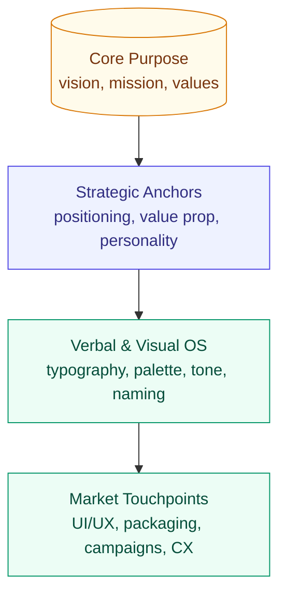
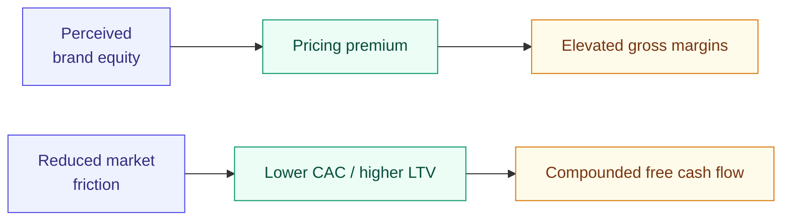
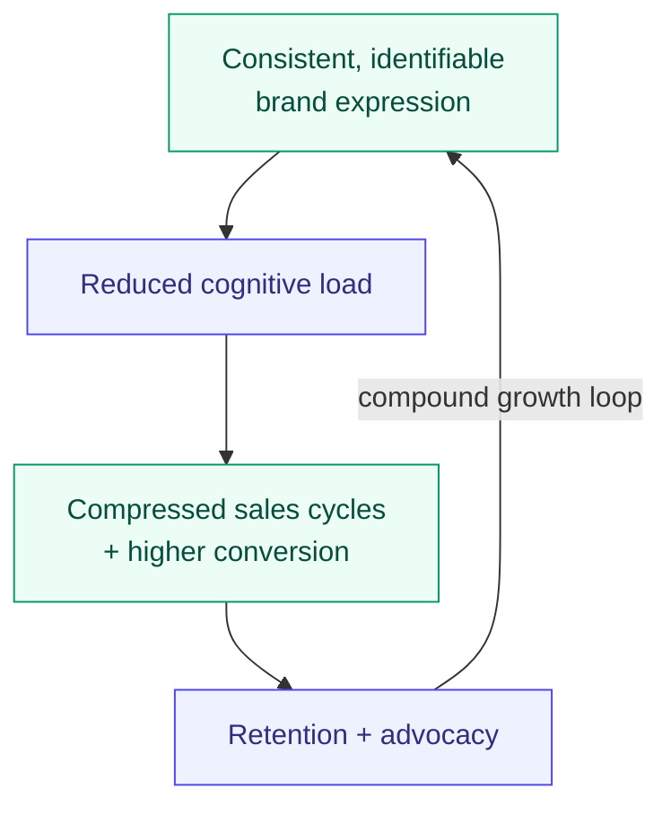

# The brand identity blueprint: from core purpose to market touchpoints.

*The four-tier stack, the balance-sheet case, the growth loop, and the Brand OS that runs it all.*

Brand identity is not the aesthetic layer of a business. It's the structural scaffolding that aligns organizational culture, product engineering, and market communication — a deliberate configuration of internal values and external expressions. This blueprint maps the whole stack: what it's made of, what it's financially worth, how it drives growth, and how world-class companies operate it.

## The four-tier architecture

Every durable identity is a hierarchy with one source of truth at the top. Change flows downward only — a touchpoint never redefines the purpose:

*The four-tier identity stack. Hierarchical composition with one source of truth — a checkout page can't contradict the mission without the whole system noticing.*

| Tier | Strategic imperative | Operational metric | Risk of failure |
| --- | --- | --- | --- |
| Ideological | Align internal talent and long-term roadmap | Employee retention, culture health | Disjointed, cynical company culture |
| Strategic | Carve out a defensible market niche | Market share, pricing premium | Commodity trap — competing on price alone |
| Expression | Instant cognitive recognition | Brand recall, attribution scores | Indistinguishable from competitors |
| Activation | Frictionless customer journey | NPS, LTV | Breaking the brand promise at checkout |

## The balance sheet case — branding as a financial asset

Effective branding converts intangible equity into tangible returns through two chains that end in free cash flow: perceived equity buys pricing power which expands gross margin, and reduced market friction cuts CAC while maximizing LTV.

*The two financial chains of brand equity. Both terminate in cash flow — which is why brand belongs in board meetings, not just marketing reviews.*

| Financial vector | Commodity entity | Branded market leader | Impact |
| --- | --- | --- | --- |
| Pricing elasticity | High — price cuts drive volume | Low — price increases accepted | Direct gross margin expansion |
| CAC : LTV ratio | 1:3 or worse, paid-media heavy | 1:5 or better, organic-heavy | Drastic acquisition cost reduction |
| Talent acquisition | Premium salaries required | Talent discount, higher inbound | Lower recruitment overhead |
| M&A goodwill multiplier | 1.0–1.5× asset value | 3.0–10.0×+ enterprise multiplier | Exponentially higher terminal value |

## The growth engine — how identity compresses the funnel

Identity drives growth by acting as a psychological shortcut: it reduces the consumer's cognitive load, which compresses sales cycles, which feeds retention and advocacy — a compounding loop, not a campaign.

*The compound growth loop. Four vectors ride it: velocity compression, virality multipliers, cheaper market expansion, and moat fortification.*

| Growth vector | Mechanism | KPI |
| --- | --- | --- |
| Sales cycle compression | Pre-established trust shortens nurturing | Days-to-close |
| Cross-sell velocity | Trust transfers from anchor product | Expansion ARR / AOV |
| Organic referral ecosystem | Distinct identity is shareable | K-factor (viral coefficient) |
| Churn insulation | Emotional and systemic lock-in | Net revenue retention |

## Strategy and positioning — the cascade

Brand strategy is the bridge between business strategy (revenue goals, market share targets) and creative activation (visual system, copy, marketing). It cascades — never jumps: audience insight, competitive gap-mapping, archetype formulation, messaging architecture, then the architecture model for the portfolio itself:

| Architecture model | Topology | Advantage | Risk |
| --- | --- | --- | --- |
| Branded House | One master brand across all products (Apple) | Marketing efficiency, cross-benefit | One crisis damages the whole portfolio |
| House of Brands | Independent standalone brands (P&G) | Targeted messaging, localized risk | Extreme capital needs, zero shared equity |
| Endorsed House | Independent brands backed by master (Courtyard by Marriott) | Shared credibility, distinct markets | Complex naming and messaging systems |

Positioning itself is one falsifiable structure: for [target segment] who experience [validated pain], our brand is [category] that provides [advantage competitors can't easily replicate] — unlike [primary alternative], we [value axiom]. Every claim in it needs a verification data point, or it's a slogan wearing a strategy costume.

## The psychology layer — designing for two brains

Branding operates in the subconscious first: sensory inputs hit emotional valuation before conscious thought does, and rationalization arrives later to justify what the amygdala already decided. Three biases do most of the commercial work:

| Phenomenon | Definition | Activation method |
| --- | --- | --- |
| Halo effect | One polished impression elevates everything else | Over-invest in premium core touchpoints |
| Mere exposure | Familiarity itself breeds preference | Relentless omni-channel consistency |
| In-group favoritism | People favor their own reference group | Build community and identity, not just features |

## The Brand OS — institutionalizing the identity

Guidelines that live in PDFs die in PDFs. A Brand Operating System stores the identity as production infrastructure: design tokens (JSON, Git-versioned), a voice-and-tone playbook with guardrails, a DAM with strict naming conventions, and a governance workflow that lints assets before they ship.

| Asset class | Format standard | Storage | Access |
| --- | --- | --- | --- |
| Design tokens | JSON / Style Dictionary | Git repo / Figma variables | Engineering + design leads |
| Vector geometry | Optimized SVG | Cloud DAM | Company-wide read-only |
| Typography | WOFF2 (web), OTF (desktop) | CDN | Full enterprise access |
| Editorial guidelines | Markdown docs | Internal wiki | Content + marketing teams |

One taxonomy prevents most cross-team confusion: the logo is the signature (changes once a decade), the visual identity is the system around it — type, palette, patterns (refreshes every 3–5 years), and the brand identity is the whole ecosystem including values, voice and CX (evolves continuously). Budget fights usually start when someone asks for tier one and means tier three.

## Measuring the ROI — leading proxies to lagging cash

Brand ROI hides from last-click attribution, so measure it in three tiers: leading proxies (share of search, direct traffic growth, falling branded CPC), operational efficiency (higher CTR, compressed sales cycles), and lagging financial realization (margin expansion, retention, lower cost of capital). The executive dashboard needs exactly three numbers: share of search in category, blended CAC savings quarter-over-quarter, and retention-driven margin expansion.

## The world-class execution checklist

1. Strategic positioning alignment: does this initiative serve the core position, and which validated pain point does it address?
2. Brand OS compliance: are all assets pulled from current design tokens, and has copy passed the tone playbook?
3. Internal alignment: is the brand embedded in onboarding and performance reviews — not just the marketing wiki?
4. Measurement capability: are tracking protocols in place, and is one primary success metric named before launch?

> World-class brands are not designed. They are operated — and the operating discipline, not the logo, is what competitors can't copy.
