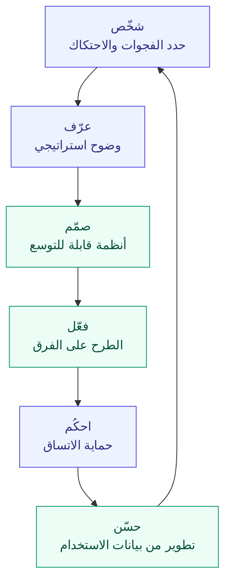
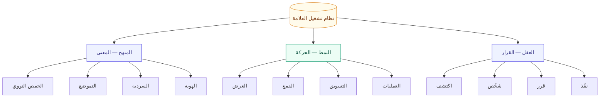
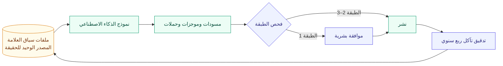

# نظام تشغيل العلامة التجارية: من الأصول الساكنة إلى البنية الديناميكية.

*اثنا عشر ركناً، حوكمة مدرجة بالمخاطر، وأدلة يستطيع نموذج لغوي استهلاكها فعلاً.*

تآكل العلامة التجارية ليس مشكلة جمالية — بل تسريب في قائمة الأرباح والخسائر. الشركات المتوسطة والكبيرة تخسر ما يقدر بستة ملايين دولار سنوياً بسبب العرض غير المتسق لعلامتها، بينما يرتبط الاتساق بزيادة إيرادات تقارب 23%. ملف الـ PDF الساكن لم يكن قادراً يوماً على حماية هذا الخط: إنه لقطة ثابتة تحاول حوكمة نظام متحرك.

> الشعار يجعلك ملحوظاً. النظام يجعلك قابلاً للتمييز دائماً.

- **$6M** — خسارة سنوية بسبب العرض غير المتسق
- **23%** — زيادة إيرادات مرتبطة بالاتساق
- **12** — ركناً في معمارية نظام التشغيل
- **3** — طبقات حوكمة من المقفول للخدمة الذاتية

## من الأصول الساكنة إلى البنية التحتية الديناميكية

نظام تشغيل العلامة التجارية ليس دليل استخدام. إنه منطق التشغيل تحت كل ما تنتجه الشركة: الاستراتيجية التي توجه، وسير العمل الذي يحرك، ومرشح القرار الذي يحفظ صدق الاثنين. وهو يعمل كحلقة مستمرة لا كمشروع ينتهي:

*حلقة BrandOS. النيلي = عمل القرار، الأخضر = عمل البناء. العلامة التي تتوقف عن الدوران تبدأ في التآكل.*

## معمارية الاثني عشر ركناً

العلامة القابلة للتوسع تُبنى عبر ثلاثة نطاقات: المنهج يصنع المعنى، والنمط يصنع الحركة، والعقل يضبط كل قرار بينهما. اثنا عشر ركناً في هرم واحد:

*التكوين الهرمي للأركان الاثني عشر. فرع العقل هو مرشح الأشياء اللامعة: لا شيء يُطلق قبل المرور باكتشف ← شخّص ← قرر ← نفّذ.*

التموضع الضعيف هو الفشل البنيوي الأكثر شيوعاً: "مبتكرون" و"نركز على العميل" ليست مواقف، بل ورق حائط. الموقف جملة واحدة قابلة للدحض — لمن، وما الذي يتغير لهم، ولماذا أنت دون البديل. إذا استطاع منافسك لصق عبارة تموضعك على موقعه دون تعديل، فأنت لا تملك تموضعاً.

## حوكمة بلا اختناقات — نظام الطبقات

الحوكمة تفشل في اتجاهين: مرتخية فتتآكل العلامة، أو مشدودة فتلتف الفرق حولها. الحل هو تحكم مدرج بالمخاطر — مقفول حيث الأخطاء مكلفة، وخدمة ذاتية حيث السرعة أهم:

| الطبقة | نوع المحتوى | منطق الحوكمة |
| --- | --- | --- |
| الأولى — خطر مرتفع | عروض المستثمرين، القانوني، صفحات التسعير | عناصر مقفولة وموافقة إلزامية |
| الثانية — متوسط | عروض المبيعات، أوراق المنتج | جوهر مقفول مع تخصيص ذاتي |
| الثالثة — منخفض | تحديثات داخلية، مطبوعات فعاليات محلية | قوالب مفتوحة بحواجز دنيا |

مقياس صحة هذا النظام هو تبني الخدمة الذاتية: ما نسبة المحتوى الصادر من القوالب المحكومة مقابل الطلبات المخصصة؟ ارتفاع النسبة يعني أن النظام صار طريق أقل مقاومة. انخفاضها يعني أن الفرق تلتف حوله — وأن تدقيق التآكل تأخر عن موعده.

## واقع 2026 — حارس علامتك القادم نموذج لغوي

أدلة العلامة صارت تُستهلك من نماذج ذكاء اصطناعي تنتج محتوى يومياً. إن لم يكن نظامك مهيكلاً للاستهلاك الآلي، سيملأ النموذج الفراغات بمخرجات عامة — تآكل علامة بسرعة الآلة. أربعة ملفات Markdown تشكل الحد الأدنى من السياق:

- about-me.md — التموضع والتمايز والقطاعات المستهدفة: حقيقة العلامة في فقرة واحدة.
- brand-voice.md — المفردات وأنماط النبرة وأزواج التباين (سطر على الهوية مقابل سطر خارجها، جنباً إلى جنب).
- visual-brand.md — مبادئ التصميم التي توجه الموجزات المولدة: قواعد الهرمية، تدفق البيانات من مصدر وحيد، والواجبات الدلالية للألوان.
- working-style.md — صيغ المخرجات الافتراضية وعتبات الموافقة ومسارات التصعيد.

*خط أنابيب العلامة المدمج بالذكاء الاصطناعي. ملفات السياق هي المصدر الوحيد للحقيقة، وحلقة التدقيق تعيد بيانات الاستخدام الفعلي إليها.*

## خارطة التنفيذ — 180 يوماً

| المرحلة | الأيام | الخطوات |
| --- | --- | --- |
| التشخيص والمواءمة | 1–30 | تدقيق العلامة، مقابلات أصحاب المصلحة، تسمية مالك قرار العلامة |
| الهندسة والتوثيق | 31–90 | مركزة الأصول في مركز واحد، بناء مكتبة المكونات، كتابة ملفات السياق الأربعة |
| التفعيل والتدريب | 91–180 | إطلاق داخلي، قوالب خدمة ذاتية لكل دور، بدء إيقاع المراجعة |

> في عصر الذكاء الاصطناعي يمكن استنساخ كل شيء في مخرجاتك خلال ظهيرة واحدة — إلا الثقة التي كسبتها علامتك بالفعل. هذا هو الخندق الوحيد الذي يتراكم.
