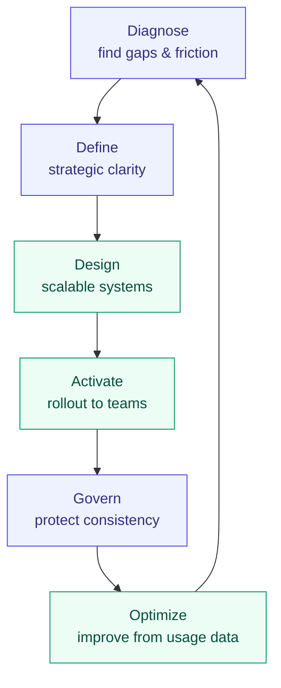
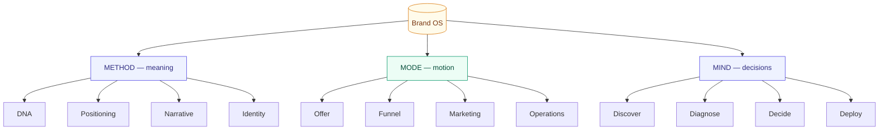
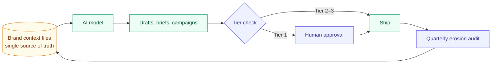

# The Brand OS: from static assets to dynamic infrastructure.

*Twelve pillars, tiered governance, and guidelines a language model can actually consume.*

Brand dilution is not an aesthetic problem — it's a leak in the P&L. Mid-to-large businesses lose an estimated $6M a year in revenue to inconsistent brand presentation, while consistent presentation is associated with roughly 23% revenue lift. The static PDF guideline was never going to hold that line: it's a snapshot trying to govern a moving system.

> Logos get you noticed. Systems keep you recognizable.

- **$6M** — Lost yearly to inconsistent brand presentation
- **23%** — Revenue lift from consistent presentation
- **12** — Pillars in the Brand OS architecture
- **3** — Governance tiers, locked to self-serve

## From static assets to dynamic infrastructure

A Brand Operating System is not a style guide. It's the operating logic underneath everything the company makes: the strategy that steers, the workflows that move, and the decision filter that keeps both honest. It runs as a continuous loop, not a one-time project:

*The BrandOS loop. Indigo = decision work, green = build work. A brand that stops looping starts eroding.*

## The 12-pillar architecture

A scalable brand is built across three domains. The Method defines meaning, the Mode drives motion, and the Mind disciplines every decision in between. Twelve pillars, one hierarchy:

*Hierarchical composition of the 12 pillars. The Mind branch is the anti-shiny-object filter: nothing ships without passing Discover → Diagnose → Decide → Deploy.*

Weak positioning is the most common structural failure: "innovative" and "customer-focused" are not positions, they're wallpaper. A position is one falsifiable sentence — who it's for, what changes for them, and why you over the alternative. If a competitor could paste your positioning statement onto their site without edits, you don't have one.

## Governance without bottlenecks — the tier system

Governance fails in two directions: too loose and the brand erodes, too tight and teams route around it. The fix is risk-tiered control — locked where mistakes are expensive, self-serve where speed matters more:

| Tier | Content class | Governance logic |
| --- | --- | --- |
| Tier 1 — High risk | Investor decks, legal, pricing pages | Locked elements, mandatory approval |
| Tier 2 — Moderate | Sales decks, product sheets | Locked core, self-serve personalization |
| Tier 3 — Low risk | Internal updates, local event flyers | Open templates, minimal guardrails |

The health metric for this system is self-serve adoption: what percentage of content ships from governed templates versus custom requests. Rising adoption means the system is the path of least resistance. Falling adoption means teams are routing around it — and the erosion audit is overdue.

## 2026 reality — your next brand guardian is a language model

Brand guidelines are now consumed by AI models generating content daily. If the system isn't structured for machine consumption, the model fills the gaps with generic output — brand erosion at machine speed. Four markdown files form the minimum viable context:

- about-me.md — positioning, differentiation, target industries: the one-paragraph truth of who this brand is.
- brand-voice.md — vocabulary, tone patterns, and contrast pairs (on-brand line vs. off-brand line, side by side).
- visual-brand.md — design principles that steer generated briefs: hierarchy rules, single-source-of-truth data flows, semantic color duties.
- working-style.md — default output formats, approval thresholds, escalation paths.

*AI-integrated brand pipeline. The context files are the single source of truth; the audit loop feeds real usage back into them.*

## Implementation roadmap — 180 days

| Phase | Days | Moves |
| --- | --- | --- |
| Diagnose & align | 1–30 | Brand audit, stakeholder interviews, name the brand decision-owner |
| Architect & document | 31–90 | Centralize assets in one hub, build the component library, write the four AI context files |
| Activate & train | 91–180 | Internal launch, self-serve templates per role, start the review pulse |

> In the age of AI, everything about your output can be cloned in an afternoon — except the trust your brand has already earned. That's the only moat that compounds.
