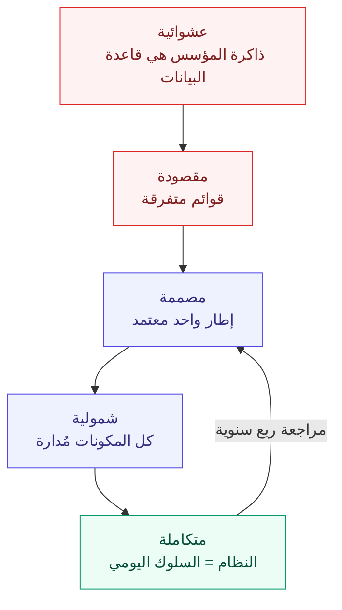
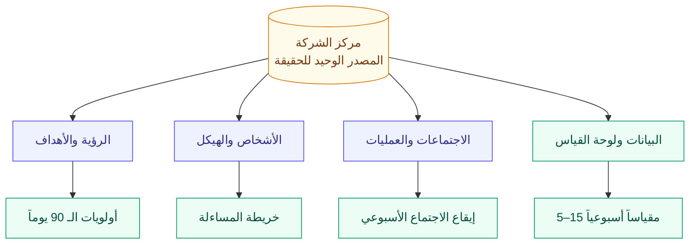
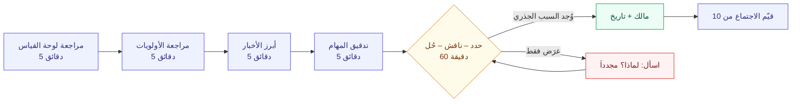

# نظام تشغيل الأعمال: أدر الشركة كبرمجية.

*سلم النضج، القياس الحي، وإيقاع الاجتماعات الذي يحل محل ذاكرة المؤسس.*

معظم الشركات لا تصطدم بسقف النمو لأن المنتج توقف عن العمل، بل لأن التعقيد الداخلي تجاوز الوضوح التنظيمي — وذاكرة المؤسس توقفت عن التوسع. الحل ليس مزيداً من الجهد، بل نظام تشغيل للأعمال (BOS): المجموعة الموثقة والمتكاملة من البروتوكولات التي تحدد كيف تتصرف الشركة حين لا يراقبها أحد.

> الشركة التي تعمل بغريزة شخص واحد هي شخصية. الشركة التي تعمل بنظام هي أصل قابل للنمو.

## سلم النضج — أين تقف شركتك الآن؟

كل مؤسسة تقع في مكان ما على سلم من خمس مراحل. التشخيص الصادق أهم من التسمية، لأن لكل مرحلة نمط فشل مختلف — وخطوة تالية مختلفة.

| المرحلة | الخصائص | مستوى الخطر |
| --- | --- | --- |
| عشوائية | رد فعل، ارتجال، لا توثيق — شائعة في البدايات | مرتفع: التوسع مستحيل بنيوياً |
| مقصودة | جهود منهجية لكنها متفرقة | متوسط: البقاء يعتمد على بطولات فردية |
| مصممة | تبني إطار خارجي مجرب (EOS أو Scaling Up) | منخفض: يبدأ النمو المتوقع |
| شمولية | إدارة كل المكونات التشغيلية الرئيسية | أدنى حد: الشركة تعمل كسفينة محكمة |
| متكاملة | الأنظمة مندمجة في العمل اليومي | مثالي: المؤسسة تدير نفسها |

*سلم نضج نظام التشغيل. الأحمر = مراحل هشة، النيلي = حوكمة مثبتة، الأخضر = إدارة ذاتية. حلقة الرجوع مقصودة: النضج يُصان ولا يُنجز مرة واحدة.*

## تسع كفاءات ومصدر وحيد للحقيقة

نظام التشغيل العامل يتقن تسع كفاءات: الرؤية، العميل، الأهداف، الأشخاص، الهيكل، البيانات، الاجتماعات، العمليات، وقيمة المؤسسة. الفخ المعتاد أن تُبنى كل كفاءة في أداة مختلفة يملكها شخص مختلف. القاعدة المعمارية: كل كفاءة تقرأ من مركز واحد وتكتب إليه — لا جداول خاصة على أجهزة الأفراد.

*تكوين هرمي: مركز واحد، أربعة فروع حوكمة، أربعة مخرجات تنفيذية. إذا وُجد رقم في مكانين، فأحدهما خاطئ بالفعل.*

## القياس — قِس كمهندس لا كمحاسب

لوحة القياس تنجح عندما يستطيع فريق القيادة تقييم صحة الشركة في أقل من خمس دقائق. وهذا يتطلب فصل ثلاثة أنواع من الإشارات:

| فئة المقياس | الغرض | مثال |
| --- | --- | --- |
| مؤشرات استباقية | التنبؤ بالتغير مبكراً بما يسمح بالتصرف | عملاء محتملون مؤهلون أسبوعياً، سرعة خط المبيعات |
| مؤشرات لاحقة | فرض المساءلة على النتائج | إيراد الربع، الهامش، معدل الفقد |
| مقاييس الاحتكاك | كشف مواضع التسريب في النظام | تكلفة الاستحواذ، تذاكر الدعم لكل عميل، ساعات البحث عن معلومة |

الصف الأخير ليس للزينة: الموظف يفقد نحو 1.8 ساعة يومياً في البحث عن معلومات كان التوثيق سيجيب عنها. هذا يوم عمل كامل أسبوعياً لكل موظف — مدفوع الأجر ومُهدر.

## حلقة التنفيذ — الاجتماع كنبض للنظام

اجتماع Level 10 الأسبوعي هو دورة الساعة في نظام التشغيل: نفس الأجندة، نفس التسعين دقيقة، كل أسبوع. المشكلات لا تُناقش عشوائياً في الممرات — بل تُدرج وتُرتب وتُحل نهائياً عبر منهجية IDS: حدد الجذر، ناقش مرة واحدة، حُل بمالك مسمى وتاريخ محدد.

*حلقة الاجتماع الأسبوعي. المسار الأحمر هو الانضباط نفسه: العرَض يعود إلى القائمة حتى يظهر السبب الجذري.*

## قالب التنفيذ — سباق التوثيق في 30 يوماً

| الأسبوع | الخطوة | المخرَج |
| --- | --- | --- |
| 1 — التدقيق | حصر كل العمليات وتقييمها بالتكرار × الخطر × التعقيد | قائمة عمليات مرتبة بالأولوية |
| 2 — المسودة | كتابة إجراءات تشغيل قياسية لأعلى 5 عمليات تأثيراً | خمس وثائق SOP بصيغة موحدة |
| 3 — الاختبار | شخص غريب عن العملية يتبع الوثيقة كما هي | سجل احتكاك ومسودات منقحة |
| 4 — التثبيت | تعيين مالكين وجدولة مراجعات ربع سنوية | توثيق حي له نبض |

كل وثيقة SOP تتبع نفس المواصفة: اسم دلالي (Lead.Handoff.Sales لا "ملف المبيعات النسخة 3")، ومحفّز يبدأها، ومالك مسؤول، وخطوات مرقمة، وتعريف قابل للقياس للاكتمال. الخطوة التي لا يستطيع غريب اتباعها ليست موثقة — بل مزخرفة.

## عتبة النضج

النظام لا يكتمل حين يُوثق، بل حين يصبح طريق أقل مقاومة — حين يكون اتباعه أسهل من الالتفاف عليه. عندها يتوقف المؤسس عن كونه عنق الزجاجة، وتتوقف الشركة عن كونها وظيفة لتصبح بنية تحتية.

1. اختر إطاراً مجرباً هذا الربع — لا تخترع نظام تشغيل خاصاً قبل أن تدير نظام غيرك.
2. أطلق لوحة القياس: 5–15 مقياساً أسبوعياً، لكل مقياس مالك واحد، مرئية للجميع.
3. ابدأ إيقاع الاجتماع الأسبوعي هذا الأسبوع. الاجتماعات الثلاثة الأولى ستبدو متكلفة. الرابع سيبدو لا غنى عنه.
