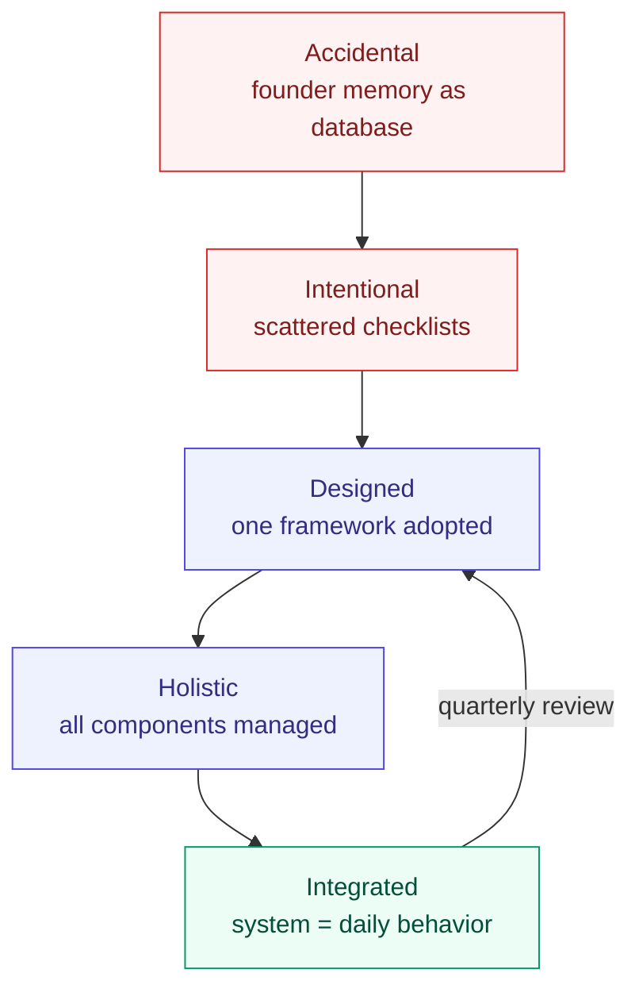
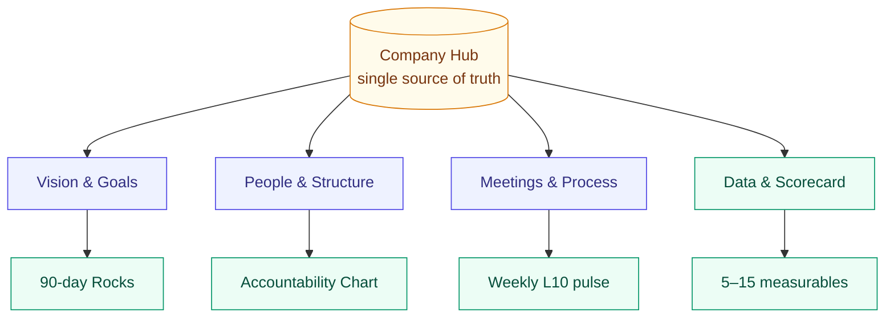
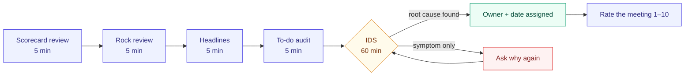

# The Business Operating System: run the company like software.

*The maturity ladder, telemetry, and the meeting pulse that replaces founder memory.*

Most companies don't hit a growth ceiling because the product stops working. They hit it because internal complexity outgrows organizational clarity — and the founder's memory stops scaling. The fix isn't more hustle. It's a Business Operating System: the documented, integrated set of protocols that defines how the company behaves when nobody is watching.

> A business that runs on one person's instincts is a personality. A business that runs on a system is an asset.

## The maturity ladder — where is your company right now?

Every organization sits somewhere on a five-stage ladder. The honest diagnosis matters more than the label, because each stage has a different failure mode — and a different next move.

| Stage | Characteristics | Risk profile |
| --- | --- | --- |
| Accidental | Reactive, ad hoc, undocumented — common in early startups | High: scaling is structurally impossible |
| Intentional | Deliberate but disjointed systemization efforts | Medium: survival depends on individual heroics |
| Designed | Adopts a proven external framework (EOS, Scaling Up) | Low: predictable growth begins |
| Holistic | All major operational components managed | Minimal: the business runs as a tight ship |
| Integrated | Systems unified into daily working life | Optimized: the organization self-manages |

*The BOS maturity ladder. Red = fragile stages, indigo = governance installed, green = self-managing. The loop back is deliberate: maturity is maintained, not achieved.*

## Nine competencies, one source of truth

A working BOS masters nine competencies — vision, customer, goals, people, structure, data, meetings, process, and enterprise value. The trap is building each one in a different tool owned by a different person. The architecture rule: every competency reads from and writes to one central hub, never to private spreadsheets.

*Hierarchical composition: one hub, four governance branches, four execution artifacts. If a number exists in two places, one of them is already wrong.*

## Telemetry — measure like an engineer, not like an accountant

A scorecard works when the leadership team can assess company health in under five minutes. That requires separating three kinds of signal:

| Metric category | Purpose | Example measurable |
| --- | --- | --- |
| Leading indicators | Predict change early enough to act | New qualified leads per week, pipeline velocity |
| Lagging indicators | Enforce accountability on outcomes | Quarterly revenue, margin, churn |
| Friction metrics | Expose where the system leaks | CAC, support tickets per customer, hours lost searching for information |

That last row is not decorative: employees lose roughly 1.8 hours every day searching for information that documentation would have answered. That is a full working day per week, per person, paid for and thrown away.

## The execution loop — meetings as system clock

The weekly Level 10 meeting is the BOS's clock cycle. Same agenda, same 90 minutes, every week. Issues don't get discussed ad hoc in hallways — they get queued, prioritized, and permanently resolved through IDS: Identify the root cause, Discuss once, Solve with a named owner and a date.

*The Level 10 loop. The red path is the discipline: a symptom re-enters the queue until the root cause surfaces.*

## Implementation template — the 30-day documentation sprint

| Week | Move | Output |
| --- | --- | --- |
| 1 — Audit | List every process; score by frequency × risk × complexity | Prioritized process inventory |
| 2 — Draft | Write SOPs for the top 5 high-impact processes | 5 SOPs in one shared format |
| 3 — Test | Someone unfamiliar follows each SOP cold | Friction log, revised drafts |
| 4 — Systematize | Assign owners, schedule quarterly reviews | Living documentation with a pulse |

Every SOP follows the same spec: a semantic name (Lead.Handoff.Sales, not "sales doc v3"), a trigger, a responsible owner, numbered steps, and a measurable definition of done. If a step can't be followed by a stranger, it isn't documented — it's decorated.

## The maturity threshold

A system is not done when it's documented. It's done when it becomes the path of least resistance — when following it is easier than working around it. That's the point where the founder stops being the bottleneck, and the company stops being a job and starts being infrastructure.

1. Pick one proven framework this quarter — don't invent your own operating system before you've run someone else's.
2. Stand up the scorecard: 5–15 weekly measurables, one owner each, visible to everyone.
3. Start the Level 10 rhythm this week. The first three will feel awkward. The fourth will feel indispensable.
