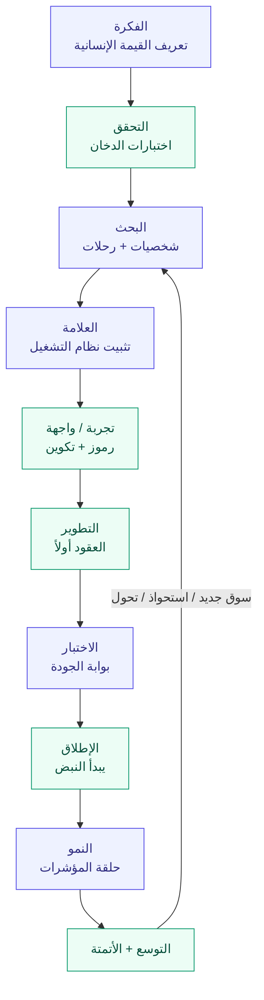
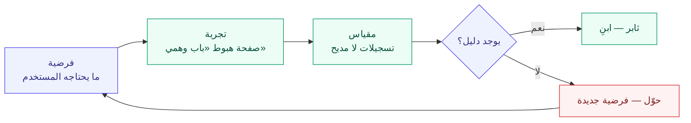

# دورة حياة المنتج الرقمي: من الفكرة إلى المؤسسة بنظام واحد.

*اختبارات الدخان، طبقة المعنى، البناء بالعقود أولاً، والحلقة التي تجعل التوسع قابلاً للتكرار.*

كل منتج رقمي يسلك نفس الطريق: فكرة، تحقق، بحث، علامة، تصميم، بناء، إطلاق، نمو، توسع. ما يفصل المنتجات التي تنجو من الرحلة ليس الموهبة في أي مرحلة منفردة — بل هيكل تنفيذي يربط المراحل، فيصبح دليل مرحلة مدخلاً للتالية بدل أن يموت في عرض تقديمي.

*دورة الحياة كنظام واحد. حلقة الرجوع إلى البحث هي الفرق بين التوسع ومجرد التضخم.*

## الفكرة والتحقق — الدليل قبل رأس المال

لمرحلة الفكرة مخرَج واحد مهم: بيان القيمة الإنسانية — ماذا يخسر العالم لو اختفى هذا المنتج غداً. كل ما بعده فرضية، واختبار الدخان أرخص مختبر: حدد الفرضية، أطلق صفحة هبوط تصف القيمة، قِس التسجيلات (دليل) لا المجاملات (نية)، ثم حوّل المسار أو ثابر بناء على البيانات. الفشل الكلاسيكي هو الإفراط في هندسة الـ MVP — بناء ما يبدو مبهراً بدل ما يثبت القيمة.

| المرحلة | المدة | المخرجات الأساسية |
| --- | --- | --- |
| الفكرة | 1–2 أسبوع | بيان الرؤية، بيان المشكلة، مواءمة أصحاب المصلحة |
| التحقق | 2–4 أسابيع | نتائج اختبار الدخان، قرار التحول أو المثابرة |
| البحث | 3–6 أسابيع | شخصيات استراتيجية، خرائط رحلة، مقارنة تنافسية |

*اختبار الدخان. المسار الأحمر الراجع ميزة لا فشل — التحولات رخيصة هنا ومدمرة بعد الإطلاق.*

## العلامة والتجربة — طبقة المعنى

قبل البكسلات، منطق التشغيل: الحمض النووي والتموضع والسردية والهوية (المنهج)؛ العرض والقمع والتسويق والعمليات (النمط)؛ اكتشف وشخّص وقرر ونفّذ (العقل). بتثبيت ذلك يصبح لاستراتيجية التجربة ما تتسق معه. والأرضية التكتيكية معروفة الخريطة — خمسة مستخدمين يكشفون 85% من مشكلات الاستخدام، وقابلية استخدام الدفع وحدها فرصة استرداد عالمية بـ 260 مليار دولار.

وعلى طبقة الواجهة، يحمل التكوين الهرمي وسلسلة الرموز الثلاثية (بدائي ← دلالي ← مكوّن) العلامة إلى الكود. قاعدة واحدة تنجو من كل دورات موضة الأطر: أسماء دلالية، مصدر وحيد للحقيقة، ولا أكواد Hex خام داخل المكونات.

## التطوير والاختبار — هندسة من أجل التغيير

- اقتران رخو — الخدمات تعتمد على عقود الواجهات لا على التنفيذات.
- حدود واضحة — المصادقة ومنطق الأعمال والوصول للبيانات تتطور منفصلة.
- قابلية الاستبدال — افترض أن كل جزء سيُستبدل يوماً؛ اختر التقنية للعمر الطويل لا للموضة.
- بوابة الجودة — تباين WCAG 2.1 AA ومسارات لوحة المفاتيح، وقاعدة الثواني الثلاث: 53% من مستخدمي الموبايل يغادرون صفحة أبطأ تحميلاً.

## الإطلاق والنمو والتوسع — النظام يتولى القيادة

الإطلاق ليس خط النهاية بل بداية تغذية راجعة «في البرية». نبض الإطلاق (اجتماعات أسبوعية وحل مشكلات بمنهجية IDS) يحول تلك التغذية إلى إصلاحات دائمة. ويصبح النمو مخرَجاً للنظام: جودة التهيئة تخفض تكلفة الاستحواذ، والمنتجات البديهية ترفع القيمة العمرية، ومعدل إتمام المهام يتقدم كل رقم آخر على اللوحة. ومحفزات التوسع — أسواق جديدة، محافظ جديدة، استحواذات، إعادة هيكلة — تعيد الحلقة إلى البحث، هذه المرة بحوكمة مدرجة كي لا تدفع السرعة ثمنها من الاتساق.

| رافعة دورة الحياة | الآلية | الأثر المالي |
| --- | --- | --- |
| تدفقات التهيئة | وقت أقصر حتى القيمة | خفض تكلفة الاستحواذ |
| قابلية اكتشاف الميزات | بنية معلومات على مهام المستخدم | إيرادات التوسع |
| جودة الاستخدام | إزالة الاحتكاك | تخفيف الفقد |
| التوثيق | الإجراءات تسترد 1.8 ساعة ضائعة يومياً للفرد | خفض كلفة التشغيل |

## الأتمتة — بنية تحتية قابلة للاستهلاك الآلي

الميل الأخير في دورة الحياة هو تعليم الآلات إدارتها معك. أربعة ملفات Markdown (التعريف، صوت العلامة، العلامة البصرية، أسلوب العمل) تمنح نماذج الذكاء الاصطناعي السياق لإنتاج مخرجات على الهوية دون توجيه يدوي — بما فيها أزواج التباين، لأن النموذج يتعلم من «لنبدأ. بياناتك آمنة» مقابل «اكتمل تسلسل تهيئة النظام» أسرع مما يتعلم من أي قائمة صفات.

> المنتج الرقمي ليس أصلاً ساكناً. إنه نظام حي — وعتبة النضج هي اليوم الذي يصبح فيه النظام، لا المؤسس، هو ما يتوسع.
