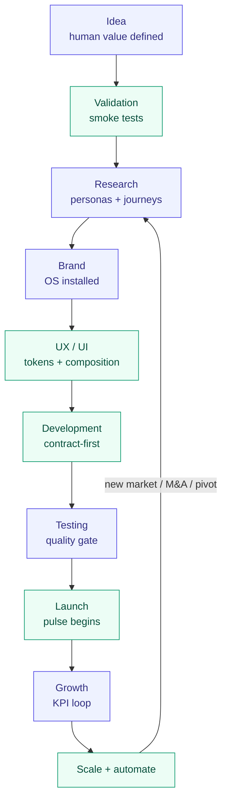
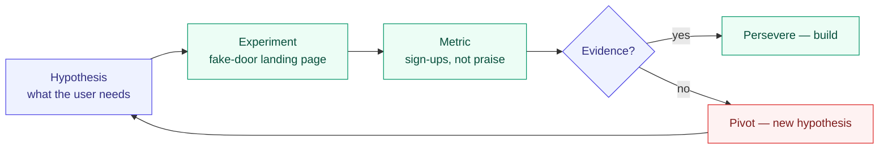

# The digital product lifecycle: idea to enterprise, one system.

*Smoke tests, the meaning layer, contract-first builds, and the loop that makes scaling repeatable.*

Every digital product travels the same road: idea, validation, research, brand, design, build, launch, growth, scale. What separates the products that survive the trip is not talent at any single stage — it's an execution chassis that connects the stages, so evidence from one becomes the input of the next instead of dying in a slide deck.

- **$260B** — Recoverable through checkout usability
- **53%** — Abandon mobile pages slower than 3s
- **85%** — Of usability issues found by 5 users
- **1.8h** — Lost daily without documentation

*The lifecycle as one system. The loop back to research is the difference between scaling and just getting bigger.*

## Idea and validation — evidence before capital

The idea stage has one deliverable that matters: the human value statement — what the world loses if this product disappears tomorrow. Everything after that is a hypothesis, and smoke testing is the cheapest lab: define the hypothesis, ship a landing page describing the value, measure sign-ups (evidence) instead of compliments (intent), then pivot or persevere on data. The classic failure is over-engineering the MVP — building what looks impressive rather than what proves value.

| Stage | Timeline | Core deliverables |
| --- | --- | --- |
| Idea | 1–2 weeks | Vision statement, problem statement, stakeholder alignment |
| Validation | 2–4 weeks | Smoke test results, pivot/persevere decision |
| Research | 3–6 weeks | Strategic personas, journey maps, competitive benchmark |

*Smoke testing. The red path back is a feature, not a failure — pivots are cheap here and ruinous after launch.*

## Brand and UX — the meaning layer

Before pixels, the operating logic: DNA, positioning, narrative, identity (the Method); offer, funnel, marketing, operations (the Mode); discover, diagnose, decide, deploy (the Mind). With that installed, UX strategy has something to be consistent with. The tactical floor is well-mapped — five users uncover 85% of usability issues, and checkout usability alone is a $260B global recovery opportunity.

On the UI layer, hierarchical composition and the three-tier token chain (primitive → semantic → component) carry the brand into code. One rule survives every framework fashion cycle: semantic names, single source of truth, no raw hex codes in components.

## Development and testing — architecting for change

- Loose coupling — services depend on API contracts, not implementations.
- Clear boundaries — auth, business logic, and data access evolve separately.
- Replaceability — assume every part gets swapped eventually; choose technology for longevity, not hype.
- Quality gate — WCAG 2.1 AA contrast and keyboard paths, plus the 3-second rule: 53% of mobile users abandon a page that loads slower.

## Launch, growth, scale — the system takes over

Launch is not the finish line; it's the start of in-the-wild feedback. The launch pulse (weekly Level 10 meetings, IDS problem-solving) turns that feedback into permanent fixes. Growth becomes an output of the system: onboarding quality pulls CAC down, intuitive products push LTV up, and task completion rate leads every other number on the dashboard. Scaling triggers — new markets, new portfolios, M&A, restructuring — send the loop back to research, this time with tiered governance so speed doesn't cost consistency.

| Lifecycle lever | Mechanism | Financial effect |
| --- | --- | --- |
| Onboarding flows | Shorter time-to-value | CAC reduction |
| Feature findability | IA aligned to user jobs | Expansion revenue |
| Usability quality | Friction removal | Churn mitigation |
| Documentation | SOPs recover 1.8 lost hours/day/person | Operating cost reduction |

## Automation — machine-consumable infrastructure

The last mile of the lifecycle is teaching machines to run it with you. Four markdown files (about-me, brand-voice, visual-brand, working-style) give AI models the context to produce on-brand output without manual briefing — including contrast pairs, because a model learns faster from "Let's get started. Your data is secure" versus "System initialization sequence complete" than from any adjective list.

> A digital product is not a static asset. It's a living system — and the maturity threshold is the day the system, not the founder, is what's scaling.
