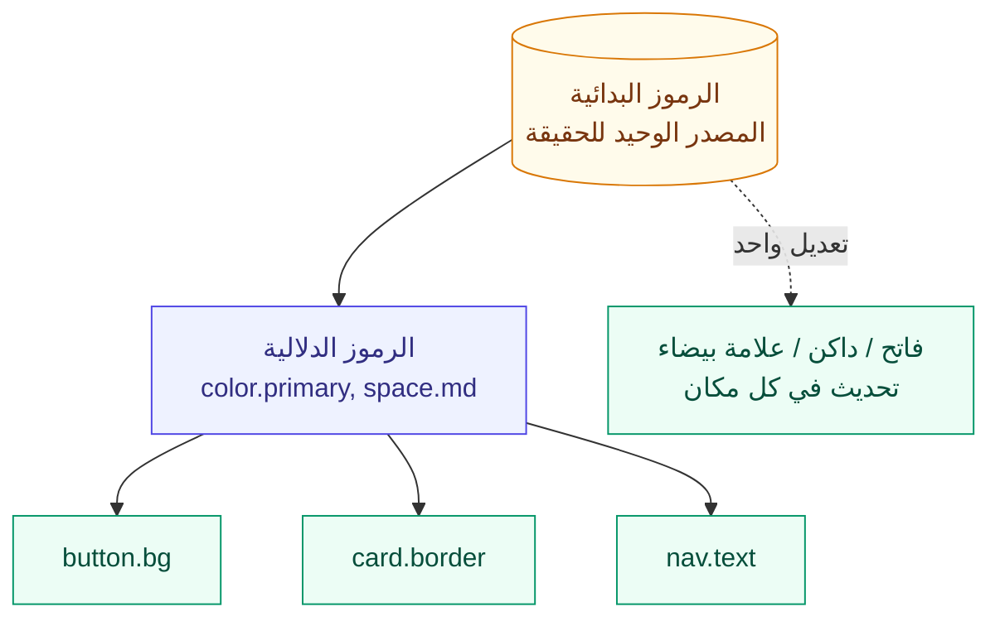
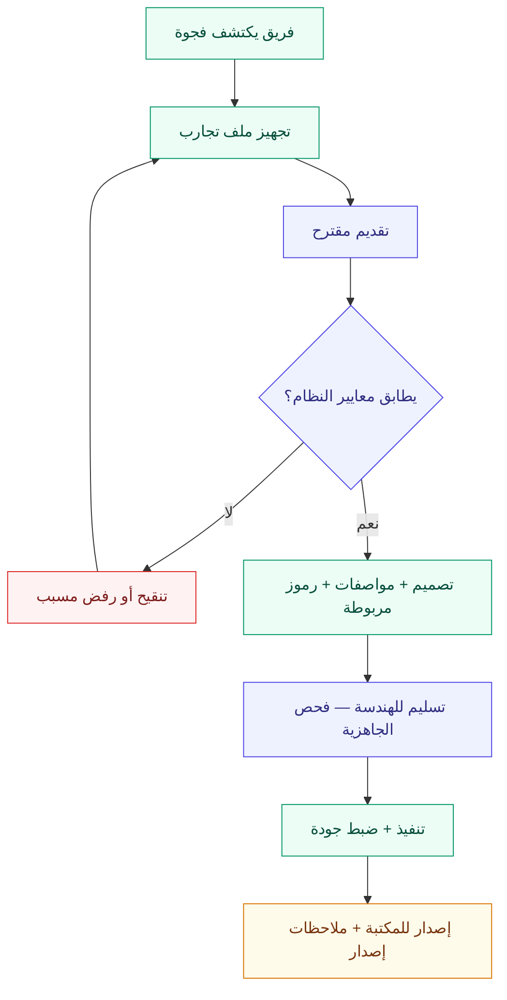

# أنظمة التصميم بنية تحتية، لا مكتبات واجهات.

*الرموز كمصدر وحيد للحقيقة، التسمية الدلالية، وحلقة المساهمة التي تبقي النظام حياً.*

المؤسسات عالية الأداء في التصميم تنمّي إيراداتها وعوائد مساهميها بضعف معدل نظرائها تقريباً. هذا الرقم لا علاقة له بأزرار أجمل، بل يأتي من معاملة التصميم كبنية تحتية: يُقاس كما تُقاس التكلفة، ويُحكم كما يُحكم الكود، ويُملك على مستوى القيادة. ونظام التصميم هو المكان الذي يتجسد فيه هذا الانضباط.

## نظام التصميم ليس مكتبة واجهات

| الأداة | ما هي | ما تحله |
| --- | --- | --- |
| مكتبة UI | أصول بصرية ساكنة في أداة تصميم | الجماليات والتخطيط |
| مكتبة مكونات | عناصر مبرمجة قابلة لإعادة الاستخدام | سرعة التنفيذ |
| نظام تصميم | قواعد + رموز + مكونات + حوكمة | مواءمة المؤسسة على نطاق واسع |

العائد ملموس: الفرق العاملة داخل نظام تُبلغ عن تسليم أسرع بنحو 50% بين التصميم والتطوير، ووقت أقل بنحو 27% في أعمال التصميم المتكررة. الآلية مملة وقوية — قرارات تُتخذ مرة واحدة، تُرمَّز، وتُورَّث في كل مكان.

## رموز التصميم — المصدر الوحيد للحقيقة

الرموز خصائص مسماة تحمل كل قرار بصري عبر ثلاث طبقات. اتجاه الإشارة هو المعمارية كلها: المكونات تشير إلى الدلالي، والدلالي يشير إلى البدائي، ولا شيء يشير إلى الخلف.

| طبقة الرمز | الغرض | مثال |
| --- | --- | --- |
| بدائي | قيم خام للاستخدام الداخلي فقط | blue_500: #3B82F6 |
| دلالي | معنى سياقي تستخدمه الفرق فعلياً | color.primary ← blue_500 |
| مكوّن | ربط خاص بعنصر محدد | button.bg ← color.primary |

*هرمية الرموز. عدّل بدائياً واحداً فترثه كل السمات والمنصات والمكونات — هذا الخط المنقط هو سبب أن تغيير السمة يستغرق ساعة لا ربع سنة.*

## التكوين الهرمي يتفوق على استعارات الكيمياء

التصميم الذري منح الصناعة نموذجاً ذهنياً، ومنحها أيضاً مسميات لا يستخدمها أحد تحت ضغط التسليم. الأنظمة الحديثة تحتفظ بالمبدأ — قطع صغيرة تتركب في أكبر منها — وتُسقط التسميات. البديل هو التسمية الدلالية: اسم المكون يعلن غرضه وسياقه، لا فئة حجمه.

- غير فعال: Organism_7 أو LargeMolecule_Button أو Component_Card_v2.
- فعال: Button.Primary أو Modal.Warning.SpeedLimit أو Navigation.Global.
- الاختبار: الموظف الجديد يجب أن يجد المكون الصحيح من اسمه وحده دون فتحه.

وسهولة الوصول تسير على نفس القضبان، وأرقامها ليست سياقاً اختيارياً: 96.3% من المواقع تفشل في فحوصات WCAG 2.1 AA الأساسية، مستبعدة ما يصل إلى 1.3 مليار إنسان يمثلون نحو 13 تريليون دولار من القوة الشرائية. نسب التباين ومسارات لوحة المفاتيح ومتطلبات النص البديل مكانها داخل توثيق المكون — لا في PDF منفصل لا يفتحه أحد.

## حلقة المساهمة — كيف يبقى النظام حياً

الأنظمة المؤسسية تموت من الجمود بقدر ما تموت من الإهمال. عملية مساهمة قابلة للتكرار هي الفرق بين منصة حية وضريح من الأزرار المعتمدة:

*حلقة المساهمة. كل رفض يعود مسبباً — هذا المسار الأحمر هو ما يجعل الفرق تقترح بدل أن تتفرع.*

## قالب التنفيذ — تعريف الجاهزية للتسليم

- الاسم الدلالي يطابق تصنيف مستودع الكود (Card.User.Profile لا FinalCard2).
- كل لون ومسافة مربوطان برمز دلالي — صفر أكواد Hex خام.
- الحالات الخمس معرفة: افتراضي، تحويم، نشط، معطل، مركز عليه.
- السلوك المتجاوب محدد لكل رمز نقطة كسر.
- معايير WCAG 2.1 AA: تباين ≥ 4.5:1 لنص المتن، تنقل كامل بلوحة المفاتيح، قواعد النص البديل مكتوبة.
- مفتاح بصري يفصل ملاحظات المنتج عن التصميم عن الهندسة.

> نظام التصميم لا يكتمل أبداً — بل تُرقَّم إصداراته. لحظة توقفه عن نشر ملاحظات الإصدار يكون قد بدأ التحول إلى PDF.

ومع توقع أن يولّد الذكاء الاصطناعي حصة كبيرة من أعمال الواجهات خلال سنوات قليلة، يكتسب نظام التصميم دوراً إضافياً: المرساة السياقية التي تُبقي الواجهات المولدة آلياً على الهوية وقابلة للوصول. الفرق التي لا تملك نظاماً لن تصبح أسرع مع الذكاء الاصطناعي — بل ستصبح غير متسقة أسرع.
