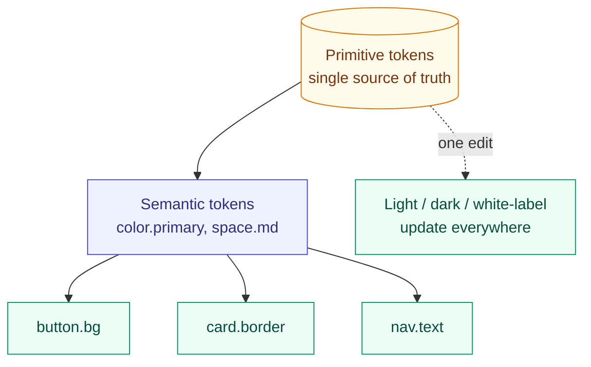
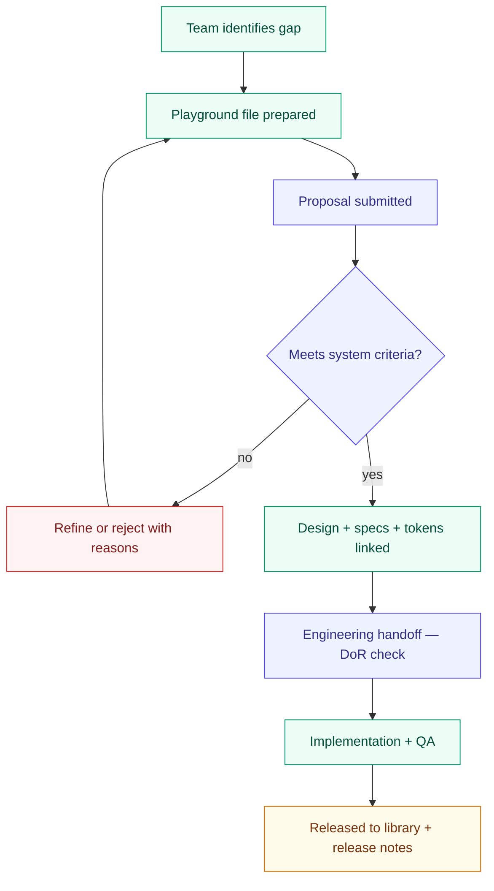

# Design systems are infrastructure, not UI kits.

*Tokens as the single source of truth, semantic naming, and the contribution loop that keeps it alive.*

High-performing design organizations grow revenue and shareholder returns at nearly twice the rate of their industry peers. That number has nothing to do with prettier buttons. It comes from treating design as infrastructure — measured like cost, governed like code, and owned at leadership level. The design system is where that discipline becomes physical.

## A design system is not a UI kit

| Artifact | What it is | What it solves |
| --- | --- | --- |
| UI kit | Static visual assets in a design tool | Aesthetics and layout |
| Component library | Coded, reusable elements | Implementation speed |
| Design system | Rules + tokens + components + governance | Organizational alignment at scale |

The ROI is concrete: teams working inside a system report roughly 50% faster design-to-development handoff and about 27% less time spent on repetitive design work. The mechanism is boring and powerful — decisions made once, encoded, inherited everywhere.

## Design tokens — the single source of truth

Tokens are named properties that carry every visual decision through three layers. The direction of reference is the whole architecture: components point to semantics, semantics point to primitives, and nothing points backwards.

| Token layer | Purpose | Example |
| --- | --- | --- |
| Primitive | Raw values, internal only | blue_500: #3B82F6 |
| Semantic | Contextual meaning teams actually use | color.primary → blue_500 |
| Component | Element-specific bindings | button.bg → color.primary |

*Token hierarchy. Change one primitive and every theme, platform and component inherits it — that dotted line is why re-theming takes an hour, not a quarter.*

## Hierarchical composition beats chemistry metaphors

Atomic design gave the industry a mental model; it also gave it names nobody uses under deadline. Modern systems keep the principle — small pieces composing into larger ones — and drop the labels. What replaces them is semantic naming: a component's name states its purpose and context, not its size class.

- Ineffective: Organism_7, LargeMolecule_Button, Component_Card_v2.
- Effective: Button.Primary, Modal.Warning.SpeedLimit, Navigation.Global.
- The test: a new hire should locate the right component from its name alone, without opening it.

Accessibility rides the same rails, and the numbers are not optional context: 96.3% of websites fail basic WCAG 2.1 AA checks, excluding up to 1.3 billion people who represent roughly $13T in spending power. Contrast ratios, keyboard paths, and alt-text requirements belong inside the component documentation — not in a separate PDF nobody opens.

## The contribution loop — how the system stays alive

Enterprise systems die from rigidity as often as from neglect. A repeatable contribution process is the difference between a living platform and a mausoleum of approved buttons:

*The contribution loop. Every rejection returns with reasons — that red path is what keeps teams proposing instead of forking.*

## Implementation template — Definition of Ready for handoff

- Semantic name matches the code repository taxonomy (Card.User.Profile, not FinalCard2).
- Every color and spacing value linked to a semantic token — zero raw hex codes.
- All five states defined: default, hover, active, disabled, focused.
- Responsive behavior specified per breakpoint token.
- WCAG 2.1 AA: contrast ratio ≥ 4.5:1 for body text, keyboard navigation mapped, alt-text rules written.
- Visual legend separates product, design, and engineering notes.

> A design system is never done — it's versioned. The moment it stops shipping release notes, it has started becoming a PDF.

With AI expected to generate a large share of interface work within a couple of years, the design system takes on one more role: it becomes the contextual anchor that keeps machine-generated UI on-brand and accessible. Teams without one won't get faster with AI — they'll get inconsistent faster.
