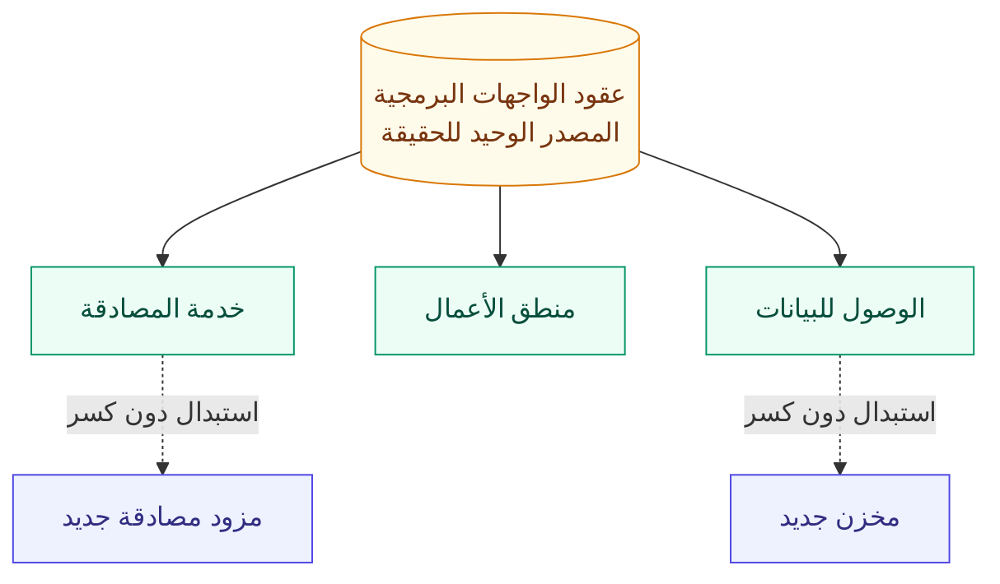

# التوسع المرتكز على المنتج: تجربة المستخدم متغير إيرادات.

*نموذج تشغيل المنتج، المعمارية التدرجية، والمقاييس الأربعة التي تحركها تجربة المستخدم فعلاً.*

التوسع ليس فعل المزيد من الأشياء، بل فعل الأشياء الصحيحة بدقة أكبر — وترك المنتج نفسه يحمل الاستحواذ والتوسع والاحتفاظ. لهذا التحول ثمن تنظيمي: إدارة المنتج تنتقل إلى طاولة القيادة (يُتوقع أن يكون لدى 70% من شركات Fortune 100 رئيس منتجات بحلول 2027)، وتجربة المستخدم تتوقف عن كونها بند تكلفة لتصبح متغير إيرادات.

- **69.8%** — متوسط هجر سلة الشراء
- **32%** — نمو إيرادات أسرع للربع الأعلى تصميماً
- **$100** — عائد كل دولار يُستثمر في التجربة
- **70%** — من Fortune 100 برئيس منتجات بحلول 2027

## نموذج تشغيل المنتج — تركيز الـ MVP مقابل تركيز المؤسسة

| الجانب | مرحلة MVP | مرحلة المؤسسة |
| --- | --- | --- |
| الهدف الأساسي | التحقق من ملاءمة الحل للمشكلة | دعم العمليات واسعة النطاق |
| المستخدمون | المتبنون الأوائل | أدوار وفرق وصلاحيات متعددة |
| المعمارية | بسيطة وسريعة البناء | نمطية قائمة على العقود |
| البيانات | تتبع أدنى | تدقيق وتحليلات وتقارير معمقة |

ثلاث قواعد تنظيمية تحفظ صدق النموذج: الفرق — لا الأفراد — هي وحدة التنفيذ؛ والمنتج لا يتبع المبيعات ولا الهندسة (كلا التحيزين مكلف بعملة مختلفة)؛ والهيكل يوازن التخصص مقابل كلفة التنسيق.

## تجربة المستخدم كمتغير مالي

متوسط هجر سلة الشراء يقارب 69.8%، وفشل قابلية الاستخدام سبب رئيسي لإلغاء اشتراكات SaaS. أمام هذا الأساس، تصبح نتيجة مؤشر مكنزي للتصميم — نمو إيرادات أسرع بنسبة 32% لدى الربع الأعلى — أقرب لفرصة مراجحة منها لإحصائية تصميم. وكل دولار يُستثمر في تجربة المستخدم يعيد ما يقدر بمئة دولار.

| مقياس النمو | كيف تحركه تجربة المستخدم |
| --- | --- |
| تكلفة الاستحواذ CAC | تحويل عضوي أعلى يقلل الاعتماد على الشراء المدفوع |
| القيمة العمرية LTV | المنتجات البديهية توسع الحسابات وتولد الإحالات |
| معدل الفقد Churn | إخفاقات الاستخدام محرك إلغاء أساسي |
| كلفة الدعم | التصميم الجيد يحل المشكلة قبل أن توجد التذكرة |

*دولاب التميز التصميمي. لا يدور إلا إذا وُجدت العقدة الأولى — لا قياس، لا دولاب.*

## المعمارية التدرجية — ابنِ لتتحقق، وصمم لتبقى

المنتج القابل للتوسع ليس المبني لمليون مستخدم من اليوم الأول، بل المبني بحيث لا تتحول اختصارات اليوم إلى رهائن الغد:

- اقتران رخو — الخدمات تعتمد على العقود، لا على دواخل بعضها البعض.
- حدود واضحة — المصادقة ومنطق الأعمال والوصول للبيانات تتطور مستقلة.
- قابلية الاستبدال — صمم بافتراض أن كل جزء سيُستبدل يوماً، لأنه سيُستبدل.

*تفكيك قائم على العقود أولاً. الاستبدالات المنقطة هي الغاية كلها: قابلية الاستبدال تُصمم ولا تُتمنى.*

## الأرضية التشغيلية — التوثيق والمواءمة

لا شيء مما سبق ينجو من الاصطدام بفريق يقضي 1.8 ساعة يومياً في مطاردة المعلومات. سباق التوثيق ذو الثلاثين يوماً (دقق ← اكتب ← اختبر بغريب ← ثبّت) هو أرخص استثمار بنية تحتية في هذه الصفحة. والمواءمة توأمه: حين تتشارك الفرق بديهية حاكمة واحدة تتوقف القرارات عن الاصطفاف في طوابير الموافقات — وتصبح الثقافة نظام التحكم بدل مسار التصعيد.

> المنتج ليس الكود. المنتج هو النظام الذي يسمح باتخاذ المئة قرار القادمة اتخاذاً صحيحاً دون اجتماع.

## تحركات القيادة — التسعون يوماً القادمة

1. ارفع مستوى المنتج: عيّن أو رقِّ دور رئيس المنتجات بملكية صريحة لاستراتيجية النمو.
2. نفّذ سباق التوثيق على العمليات الخمس الأكثر مساساً بالإيراد.
3. اعتمد التسمية الدلالية عبر التصميم والهندسة — لغة مشتركة واحدة وطبقة ترجمة أقل.
4. فعّل مقاييس تجربة المستخدم الأربعة (CAC وLTV والفقد وكلفة الدعم) وراجعها في الإيقاع الأسبوعي.
