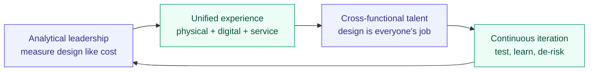
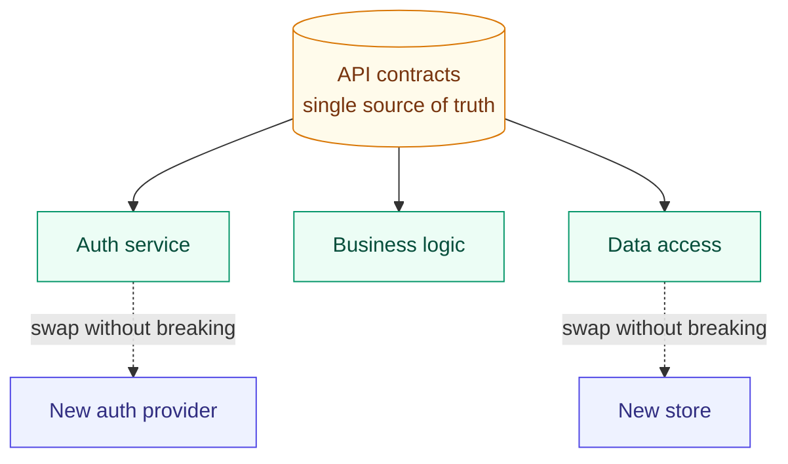

# Product-led expansion: UX is a revenue variable.

*The product operating model, progressive architecture, and the four metrics UX actually moves.*

Scaling is not doing more things. It's doing the right things with more precision — and letting the product itself carry acquisition, expansion, and retention. That shift has an organizational price: product management moves to the executive table (70% of Fortune 100 companies are expected to have a CPO by 2027), and UX stops being a cost line and becomes a revenue variable.

- **69.8%** — Average online cart abandonment
- **32%** — Faster revenue growth — top design quartile
- **$100** — Returned for every $1 invested in UX
- **70%** — Of Fortune 100 with a CPO by 2027

## The product operating model — MVP focus vs. enterprise focus

| Aspect | MVP stage | Enterprise stage |
| --- | --- | --- |
| Primary goal | Validate problem–solution fit | Support operations at scale |
| Users | Early adopters | Multiple roles, teams, permissions |
| Architecture | Simple, fast to build | Modular, contract-driven |
| Data | Minimal tracking | Audit, analytics, deep reporting |

Three organizational rules keep the model honest: teams — not individuals — are the unit of execution; product reports to neither sales nor engineering (both biases are expensive in different currencies); and structure balances specialization against coordination cost.

## UX as a financial variable

The average online cart abandonment rate sits near 69.8%, and usability failure is a leading cause of SaaS churn. Against that baseline, the McKinsey Design Index finding — top-quartile design performers growing revenue 32% faster — reads less like a design statistic and more like an arbitrage opportunity. Every dollar invested in UX returns an estimated $100.

| Growth metric | How UX moves it |
| --- | --- |
| CAC | Higher organic conversion lowers paid acquisition dependence |
| LTV | Intuitive products expand accounts and generate referrals |
| Churn | Usability failures are a primary cancellation driver |
| Support cost | Good design resolves issues before a ticket exists |

*The design-excellence flywheel. It only spins if the first node exists — no measurement, no flywheel.*

## Progressive architecture — build to validate, design to survive

The scalable product is not the one built for a million users on day one. It's the one built so that today's shortcuts don't become tomorrow's hostages:

- Loose coupling — services depend on contracts, never on each other's internals.
- Clear boundaries — authentication, business logic, and data access evolve independently.
- Replaceability — design assuming every part will eventually be swapped, because it will.

*Contract-first decomposition. The dotted swaps are the whole point: replaceability is designed, not hoped for.*

## The operational floor — documentation and alignment

None of the above survives contact with a team that spends 1.8 hours a day hunting for information. The 30-day documentation sprint (audit → draft → stranger-test → systematize) is the cheapest infrastructure investment on this page. Alignment is its twin: when teams share one governing axiom, decisions stop queuing for approval — culture becomes the control system instead of the escalation path.

> The product is not the code. The product is the system that lets the next hundred decisions be made correctly without a meeting.

## Leadership moves — next 90 days

1. Elevate product: name or promote the CPO role with explicit ownership of the growth strategy.
2. Run the documentation sprint on the five processes that touch revenue most directly.
3. Adopt semantic naming across design and engineering — one shared language, one fewer translation layer.
4. Instrument the four UX-revenue metrics (CAC, LTV, churn, support cost) and review them in the weekly pulse.
