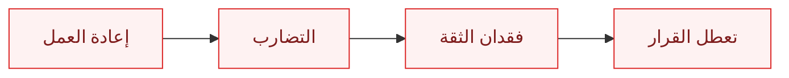
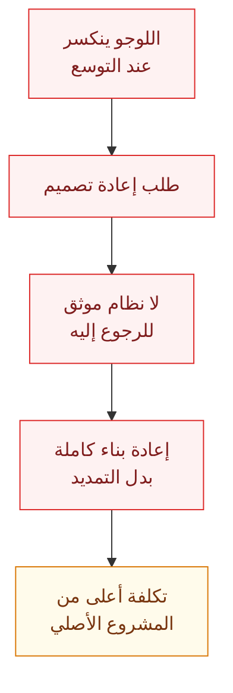
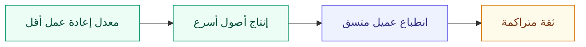

# اللوجو بـ٥٠ دولاراً: الفاتورة الخفية المتراكمة.

*طبقات التكلفة الخفية الأربع، معادلة الثقة، ولماذا يتحول الرخيص إلى أغلى قرار يتخذه المؤسس.*

اللوجو يُصرف مرة واحدة. لكن تكلفته لا تتوقف هناك — تتراكم عبر إعادة العمل، والتضارب، والثقة المفقودة نقطة تماس تلو الأخرى. العميل يرى سعراً. المصمم يرى نظاماً. ما يكلف خمسين دولاراً ليس العلامة نفسها أبداً — إنه غياب كل ما كان يمكن أن تصبح عليه العلامة.

- **4** — طبقات تكلفة خفية
- **400** — يوماً حتى تصل الفاتورة
- **5–10×** — تكلفة إعادة العمل مقابل السعر الأصلي
- **3** — نقاط تماس تنكسر أولاً

## الفاتورة الخفية ذات الطبقات الأربع

كل لوجو رخيص يحمل بنية دين مؤجلة — سلسلة التزامات تبقى غير مرئية حتى تتجاوز الشركة الحدود التي صُمم اللوجو من أجلها.

*النظام لا ينهار دفعة واحدة — يتآكل نقطة تماس تلو الأخرى، وكل انهيار يبدو مشكلة معزولة بدل أن يكون نفس السبب الجذري يتكرر.*

| الطبقة | ما ينكسر | الأثر على الأعمال |
| --- | --- | --- |
| إعادة العمل | الملف يفشل عند التكبير، التغليف، الطباعة أحادية اللون | تكلفة إعادة تصميم، 5–10× السعر الأصلي |
| التضارب | لا قواعد موثقة للألوان أو الخطوط أو المسافات | الهوية تتفكك مع كل موظف جديد |
| فقدان الثقة | عدم الاستقرار البصري يُقرأ كعدم موثوقية | انخفاض في التحويل لا يقدر العميل على تفسيره |
| تعطل القرار | لا مرجعية للخيارات الجديدة | كل قرار صغير يتحول إلى اجتماع |

## قضية الميزانية العمومية — العلامة كأصل مالي

اللوجو يُصرف مرة واحدة. النظام التجاري يُستهلك تدريجياً — يستمر في سداد تكلفة القرار كل عام يُستخدم فيه بشكل صحيح.

| المتجه المالي | لوجو رخيص | نظام هوية |
| --- | --- | --- |
| التكلفة الأولية | منخفضة | متوسطة |
| التكلفة عند الشهر ١٢ | إعادة تصميم ووقت ضائع | صفر — النظام يتوسع بالفعل |
| تكلفة القرار لكل أصل جديد | مرتفعة (تخمين في كل مرة) | شبه معدومة (القواعد موجودة) |
| تراكم الثقة | يتآكل مع كل تضارب | يُبنى مع كل نقطة تماس متسقة |

المؤسس الذي يعامل الهوية كمصروف لمرة واحدة يدفع ثمنها في كل مرة تلامس فيها الشركة سطحاً جديداً. المؤسس الذي يعاملها كبنية تحتية يدفع مرة واحدة ويعيد استخدام الإجابة إلى ما لا نهاية.

## دورة إعادة العمل — كيف تتضاعف التكلفة

فشل الهوية يسير في حلقة متكررة، وتتراكم كلما طال تجاهلها.

*بدون نظام، كل سياق جديد يُعامل كمشكلة جديدة. بنظام، كل سياق جديد يُعامل كتطبيق لإجابة موجودة بالفعل.*

| المرحلة | بدون نظام | بنظام |
| --- | --- | --- |
| ظهور استخدام جديد | إعادة تصميم اللوجو من الصفر | تمديد القواعد الموجودة |
| انضمام مصمم جديد | تخمين نية العلامة | الرجوع إلى النظام الموثق |
| حدث توسع (تغليف، لافتات) | يفشل، يتطلب إعادة بناء | تطبيق قواعد محلولة مسبقاً |

## طبقة الثقة — لماذا يشعر بها العميل قبل أن يقولها

ثقة العلامة ليست عقلانية قبل أن تكون عاطفية. العميل يسجل التضارب كنمط، لا كنقد تصميمي.

| الإشارة | كيف يقرأها العميل | كيف يراها المؤسس |
| --- | --- | --- |
| ألوان لوجو مختلفة عبر المنصات | «فيه حاجة غلط» | «تفصيلة صغيرة، مش مهمة» |
| الخط يغيّر شخصيته من منشور لآخر | عدم استقرار | مرونة توفر الوقت |
| التغليف لا يشبه الموقع | انطباع بجودة أقل | أقسام مختلفة، مش مشكلة كبيرة |

المؤسس يرى خيارات صغيرة معزولة. العميل يرى انطباعاً واحداً مستمراً. تلك الفجوة هي حيث تتسرب الثقة — والإيراد — بصمت.

## نظام تشغيل العلامة — مأسسة الهوية

النظام لا يُثمر إلا حين يُوثَّق بما يكفي ليعمل دون وجود المؤسس في الغرفة.

| طبقة النظام | ماذا تحدد | ممن تحمي |
| --- | --- | --- |
| منطق الألوان | الأساسي والثانوي وقواعد الاستخدام | انحراف الألوان العشوائي |
| هرمية الخطوط | العناوين والنصوص ومقياس الأحجام | تفاوت الوزن البصري |
| المسافات والشبكة | قواعد التخطيط عبر الصيغ | تراكيب مزدحمة أو متضاربة |
| ما يُفعل وما لا يُفعل | أمثلة صريحة للصح والخطأ | تكرار الأخطاء السابقة |

الأدلة التي تعيش فقط في رأس شخص واحد تختفي لحظة غيابه. الأدلة الموثقة على الورق تبقى أطول من أي توظيف واحد.

## قياس العائد — من الأصل إلى البنية التحتية

عائد النظام التجاري الحقيقي لا يظهر كرقم واحد — يظهر كاحتكاك أقل في كل قرار تصميم مستقبلي.

*أرخص طريقة لقياسه: عدّ كم اجتماعاً يتطلبه اعتماد منشور سوشيال ميديا جديد اليوم. النظام الحقيقي يجعل تلك الإجابة قريبة من الصفر.*

## قائمة فحص التنفيذ

1. نظام ألوان موثق — ليس فقط أكواد hex، بل قواعد استخدام.
2. هرمية خطوط مُختبرة عبر ٣ صيغ واقعية على الأقل.
3. اللوجو مُختبر بأصغر حجم وبلون واحد قبل الاعتماد.
4. ما يُفعل وما لا يُفعل مكتوباً — لا أمثلة بصرية فقط.
5. نظام يقدر موظف جديد على تطبيقه دون سؤالك أولاً.

> اللوجو صورة. النظام التجاري أداة اتخاذ قرار — وهذا ما يعجز المنافسون عن نسخه.
