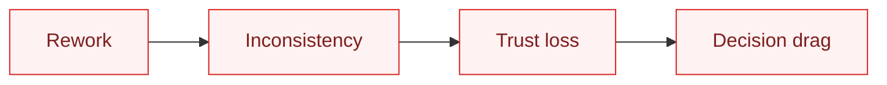
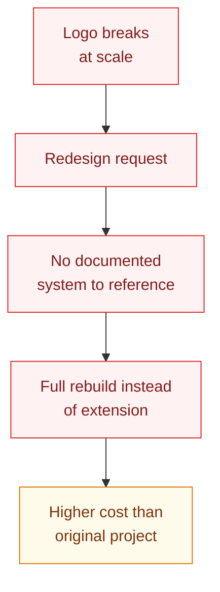
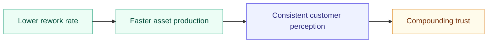

# The $50 logo: the hidden invoice that compounds.

*The four hidden cost tiers, the trust equation, and why cheap becomes the most expensive decision a founder makes.*

A logo is spent once. Its cost doesn't stop there — it compounds through rework, inconsistency, and trust lost one touchpoint at a time. The client sees a price. The designer sees a system. What costs fifty dollars is never the mark itself — it's the absence of everything the mark could have become.

- **4** — Hidden cost tiers
- **400** — Days until the bill arrives
- **5–10×** — Rework cost vs. original price
- **3** — Touchpoints where it breaks first

## The four-tier hidden invoice

Every cheap logo carries a deferred cost structure — a chain of debts that stay invisible until the business outgrows the canvas it was designed for.

*The system doesn't fail all at once — it degrades one touchpoint at a time, and each failure looks like an isolated problem instead of the same root cause repeating.*

| Tier | What breaks | Business impact |
| --- | --- | --- |
| Rework | File fails at scale, packaging, single-color print | Redesign cost, 5–10× the original spend |
| Inconsistency | No documented rules for color, type, spacing | Brand fragments across every new hire |
| Trust loss | Visual instability read as unreliability | Conversion drop customers can't articulate |
| Decision drag | No reference point for new choices | Every small decision becomes a meeting |

## The balance-sheet case — branding as a financial asset

A logo is spent once. A brand system is amortized — it keeps paying down decision cost for every year it's used correctly.

| Financial vector | Cheap logo | Brand system |
| --- | --- | --- |
| Initial cost | Low | Moderate |
| Cost at month 12 | Redesign + lost time | Zero — already scales |
| Decision cost per new asset | High (guesswork every time) | Near-zero (rules exist) |
| Trust compounding | Erodes with each inconsistency | Builds with each consistent touchpoint |

The founder who treats identity as a one-time expense pays for it every time the business touches a new surface. The founder who treats it as infrastructure pays once and reuses the answer indefinitely.

## The rework cycle — how the cost multiplies

Identity failure follows a repeatable loop, and it compounds the longer it's ignored.

*Without a system, every new context is treated as a new problem. With one, every new context is treated as an application of an existing answer.*

| Stage | Without a system | With a system |
| --- | --- | --- |
| New use case appears | Logo redesigned from scratch | Existing rules extended |
| New designer joins | Guesses at brand intent | References documented system |
| Scale event (packaging, signage) | Fails, requires rebuild | Applies pre-solved rules |

## The trust layer — why customers feel it before they say it

Brand trust isn't rational before it's emotional. Customers register inconsistency as a pattern, not as a design critique.

| Signal | Customer reads as | Founder sees as |
| --- | --- | --- |
| Different logo colors across platforms | "Something's off" | "Small detail, doesn't matter" |
| Type changing personality post to post | Instability | Time-saving flexibility |
| Packaging that looks unrelated to the website | Lower quality perception | Unrelated departments, no big deal |

The founder sees isolated small choices. The customer sees one continuous impression. That gap is where trust — and revenue — quietly leaks.

## The Brand OS — institutionalizing the identity

A system only pays off once it's documented well enough that it runs without the founder in the room.

| System layer | What it defines | Who it protects against |
| --- | --- | --- |
| Color logic | Primary, secondary, usage rules | Ad-hoc palette drift |
| Type hierarchy | Headline, body, sizing scale | Inconsistent visual weight |
| Spacing & grid | Layout rules across formats | Cramped or inconsistent compositions |
| Do's & don'ts | Explicit right/wrong examples | Repeating past mistakes |

Guidelines that only exist in someone's head disappear the moment that person is unavailable. Guidelines that exist on paper outlive any single hire.

## Measuring the ROI — from asset to infrastructure

The return on a real brand system doesn't show up as a single number — it shows up as reduced friction across every future design decision.

*The cheapest way to measure it: count how many meetings it takes to approve a new social post today. A real system should make that answer close to zero.*

## The execution checklist

1. Documented color system — not just hex codes, but usage rules.
2. Typography hierarchy tested across at least 3 real-world formats.
3. Logo tested at minimum size and in single color before approval.
4. Written do's & don'ts — not just visual examples.
5. A system a new hire could apply without asking you first.

> A logo is a picture. A brand system is a decision-making tool — and that's what competitors can't copy.
