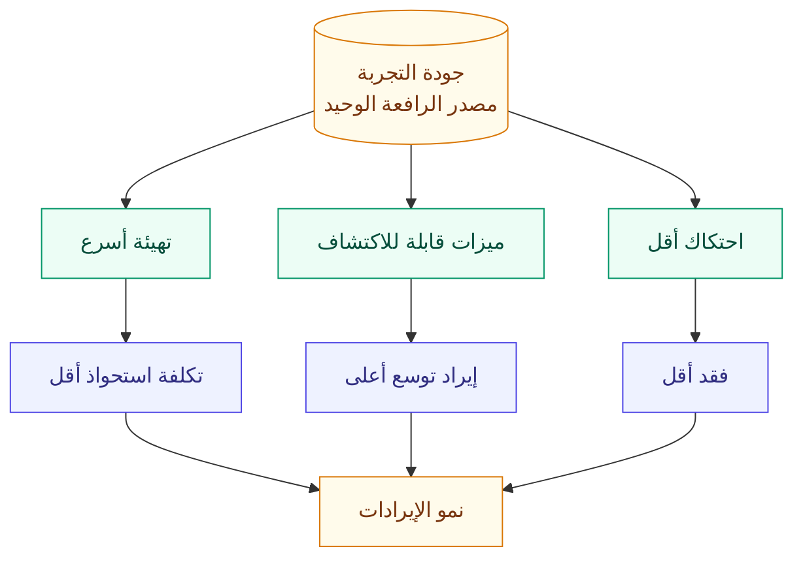

# دليل استراتيجية تجربة المستخدم: هندسة المعنى والنمو.

*الاكتشاف، مهام المستخدم، القوس العاطفي، ولوحة المؤشرات التي تربط التجربة بالإيراد.*

استراتيجية تجربة المستخدم تقع عند تقاطع استراتيجية الأعمال وتصميم المنتج — الخطة التي تنقل المؤسسة إلى حالة تجربة أعلى مع الوقت. والأرقام تحسم القضية بلا مواربة: شركات الربع الأعلى في التصميم تسجل نمو إيرادات أعلى بـ 32 نقطة مئوية ونمو عائد مساهمين أعلى بـ 56 نقطة من نظرائها. هذا الدليل هو كتيب التشغيل لالتقاط تلك الفجوة.

> المستخدم يكوّن رأيه في منتجك خلال 0.05 ثانية. الاستراتيجية هي أن تقرر مسبقاً ماذا يقول ذلك الجزء من الثانية.

## تفكير المنتج — كل شيء تجربة

تفكير المنتج القابل للتوسع يفترض أن كل قرار فرضية حتى يقول دليل السوق غير ذلك. القرارات تُبنى على البيانات لا على الأقدمية — لأن تصميم المنتجات مليء بالمشكلات الشائكة التي يكشف حل جانب منها جانبين جديدين. والشكل التنظيمي يتبع ذلك: المنتج يُرفع إلى طاولة القيادة، وأربعة أدوار تمسك الاستراتيجية معاً:

| الدور | المسؤولية في استراتيجية التجربة |
| --- | --- |
| رئيس المنتجات / مالك المنتج | مواءمة الاستراتيجية مع أهداف الأعمال وتأمين الموارد |
| قائد التجربة / مالك التصميم | الاتساق البصري والوظيفي عبر كل نقاط التماس |
| مالك الهندسة | السلامة التقنية وقابلية التنفيذ |
| باحث التجربة | جمع أدلة المستخدمين وتحليلها لتغذية كل الطبقات |

## الاكتشاف — هندسة التعاطف

أكثر من 40% من الشركات لا تتحدث مع مستخدميها النهائيين أثناء التطوير. البحث هو البنية التحتية الناعمة التي تمنع ذلك: يحدد الاحتياجات غير الملباة، ويختبر الطلب على منتجات لم توجد بعد، ويكشف مساحة المشكلة كاملة لا الواجهة فقط، ويعرّي الفجوات التي تركها المنافسون. أقوى الفرق تمزج الإشارات الكمية (تدفق النقرات، التحليل الترابطي) بالعمق النوعي (الدراسات الميدانية، الاستقصاء السياقي) — الماذا واللماذا معاً.

*سباق الاكتشاف. الحلقة بين التحقق والتجميع هي حيث يُستبدل «الإحساس» بدليل السوق.*

## علم النفس — المستخدم يشتري المعنى ثم المهمة

العملاء المرتبطون عاطفياً يحملون قيمة عمرية أعلى بـ 52% من الراضين فحسب. وتأثير الهالة يقوم بالعمل الصامت: الجودة البصرية المدرَكة تتسرب إلى الجودة الوظيفية المدرَكة، ولهذا تكسب الثواني الثلاث الأولى من الواجهة الثقة أو تخسر الجلسة. منهجية Jobs To Be Done تحوّل هذا العلم إلى أداة تصميم — تستبدل الشخصيات الديموغرافية بالصيغة: بصفتي [دوراً]، أريد [هدفاً]، لكي [دافعاً]. وبند الدافع هو الاستراتيجي: معرفة لماذا تهم الميزة تتيح لك تصميم طريق أفضل لنفس النتيجة.

- الدور — السياق المهني أو الشخصي الذي يعمل فيه المستخدم.
- المهمة — العمل الأساسي الذي يوظف منتجك لأدائه.
- الإحباطات اليومية — نقاط الاحتكاك والكوابيس.
- مقاييس النجاح — كيف يعرف شخصياً أنه أدى عملاً جيداً.

## الرحلة — رسم القوس العاطفي

خريطة الرحلة التي تتتبع النقرات فقط هي مخطط تدفق يرتدي زياً تنكرياً. النسخة الاستراتيجية ترسم الذرى والقيعان العاطفية مقابل هدف العمل في كل مرحلة:

| المرحلة | عقلية المستخدم | الهدف الاستراتيجي | متطلب التجربة |
| --- | --- | --- | --- |
| الاستكشاف | يبحث في الخيارات | بناء الثقة والمصداقية | قيمة واضحة ودليل اجتماعي |
| التجربة | يقيّم الملاءمة | تقصير الوقت حتى القيمة | تهيئة سلسة |
| الاستخدام النشط | ينجز مهامه | دفع تبني الميزات | بنية معلومات بديهية وإنجاز سريع |
| التوسع | ينمو مع الأداة | رفع القيمة العمرية | إظهار الميزات في سياقها |

بنية المعلومات هي رافعة الإيرادات الخفية في ذلك الجدول: الميزة المبنية تقنياً والمخفية تجريبياً تولّد صفراً من إيرادات التوسع. التغييرات البنيوية في المسار تتفوق بانتظام على التجديدات الجمالية — نظّم حول النموذج الذهني لمهمة المستخدم، لا حول الهيكل التنظيمي.

## قابلية الاستخدام — قاعدة الخمسة وأرضية الوصول

الاختبار مع خمسة مستخدمين فقط يكشف عادة 85% من مشكلات الاستخدام — أرخص تأمين ضد المخاطر في البرمجيات. ومع ذلك ما زالت 60% من الشركات تكتفي بنماذج أولية في مراحل الإنتاج المتأخرة، بعد أن أُقفلت القرارات المكلفة. وعلى أرضية الوصول، قائمة الإخفاقات متكررة بشكل محبط: تباين منخفض (83% من المواقع)، نص بديل مفقود (58%)، روابط فارغة (51%)، نماذج بلا تسميات (46%)، لغة صفحة مفقودة (29%). إصلاحها يوسع الوصول إلى 1.3 مليار إنسان — ولأن البنية الدلالية عامل SEO مباشر، يرفع الزيارات العضوية في الطريق.

## تجربة النمو — لوحة المؤشرات

| المقياس | الفئة | القيمة الاستراتيجية |
| --- | --- | --- |
| معدل إتمام المهام | سلوكي | مؤشر استباقي للنجاح والاحتفاظ |
| معدل تبني الميزات | سلوكي | محرك مباشر لإيرادات التوسع |
| الوقت حتى القيمة | كفاءة | متنبئ بالتفعيل والفقد المبكر |
| صافي نقاط الترويج NPS | شعوري | مؤشر لاحق للولاء والنمو العضوي |

*كيف يحرك مدخل واحد أربعة مخرجات مالية. هذا هو المخطط الذي تحمله إلى اجتماع الميزانية.*

## قالب التنفيذ — سباق تدقيق التجربة في 30 يوماً

| الأسبوع | الخطوة | المخرَج |
| --- | --- | --- |
| 1 — التشخيص | اختبارات استخدام + رسم بنية المعلومات | خط أساس من الأدلة |
| 2 — التدقيق | تحديد التدفقات المكسورة والتناقضات | جرد عيوب مرتب بالأولوية |
| 3 — الترتيب | ترتيب الإصلاحات بالأثر المالي (تحويل مقابل فقد) | قائمة أعمال مرتبة بالأثر |
| 4 — الخارطة | خارطة طريق تجربة بأهداف OKR صريحة | خطة تستطيع القيادة تمويلها |

> مع تولي الذكاء الاصطناعي حصة متنامية من أعمال الواجهات، تتحول وظيفة المصمم الاستراتيجي من صناعة البكسلات إلى حوكمة البنية التحتية للمعنى.
