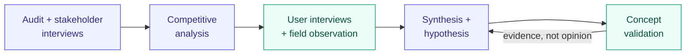
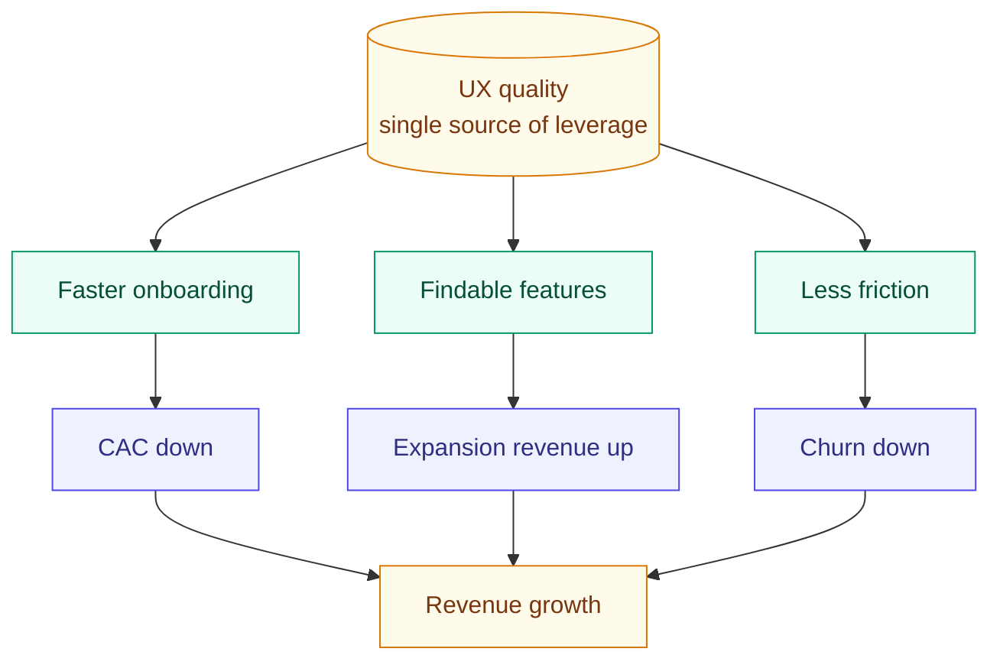

# The UX strategy playbook: engineering meaning and growth.

*Discovery, JTBD, the emotional arc, and the KPI dashboard that ties UX to revenue.*

UX strategy sits at the intersection of business strategy and product design — the plan that moves an organization to a higher state of experience over time. The numbers make the case bluntly: top-quartile design companies post 32 percentage points higher revenue growth and 56 points higher shareholder-return growth than their peers. This playbook is the operating manual for capturing that gap.

> Users form an opinion of your product in 0.05 seconds. Strategy is deciding, in advance, what that twentieth of a second says.

## Product thinking — everything is an experiment

Scalable product thinking assumes every decision is a hypothesis until market evidence says otherwise. Decisions get grounded in data, not seniority — because product design is full of wicked problems, where solving one aspect reveals two more. The organizational shape follows: product elevated to the executive table, with four roles holding the strategy together:

| Role | Responsibility in the UX strategy |
| --- | --- |
| CPO / Product owner | Aligns strategy with business goals, secures resources |
| UX lead / Design owner | Visual and functional consistency across touchpoints |
| Engineering owner | Technical integrity and implementation feasibility |
| UX researcher | Gathers and analyzes the user evidence feeding every layer |

## Discovery — the engineering of empathy

Over 40% of companies never talk to end users during development. Research is the soft infrastructure that prevents that: it identifies unmet needs, tests demand for products that don't exist yet, exposes the whole problem space instead of just the interface, and reveals where competitors left gaps. The strongest teams blend quantitative signals (clickstream, conjoint) with qualitative depth (field studies, contextual inquiry) — the what and the why.

*The discovery sprint. The loop between validation and synthesis is where 'gut feeling' gets replaced by market evidence.*

## Psychology — users buy meaning, then jobs

Emotionally connected customers carry a lifetime value 52% higher than merely satisfied ones. The halo effect does the quiet work: perceived visual quality bleeds into perceived functional quality, which is why the first three seconds of a hero section either earn trust or lose the session. Jobs To Be Done turns this psychology into a design instrument — replacing demographic personas with the formula: as a [role], I want to [goal], so I can [motivation]. The motivation clause is the strategic one: knowing why a feature matters lets you design a better route to the same outcome.

- The role — professional or personal context the user operates in.
- The job — the primary task they hire your product to do.
- Daily frustrations — the friction points and nightmares.
- Success metrics — how they personally know they did a good job.

## The journey — mapping the emotional arc

A journey map that only tracks clicks is a flowchart wearing a costume. The strategic version maps the emotional highs and lows against the business objective of each phase:

| Phase | User mindset | Strategic objective | UX requirement |
| --- | --- | --- | --- |
| Discovery | Researching options | Build trust and credibility | Clear value proposition, social proof |
| Trial | Evaluating fit | Shorten time-to-value | Seamless onboarding |
| Active use | Getting things done | Drive feature adoption | Intuitive IA, fast task completion |
| Expansion | Growing with the tool | Increase LTV | Contextual feature surfacing |

Information architecture is the invisible revenue lever in that table: a feature that is built but UX-hidden generates exactly zero expansion revenue. Structural changes to the path routinely outperform aesthetic refreshes — organize around the user's mental model of their job, never around the org chart.

## Usability — the five-user rule and the accessibility floor

Testing with just five users typically uncovers 85% of usability issues — the cheapest risk insurance in software. Yet 60% of companies still only prototype for late-stage production testing, after the expensive decisions are already locked. On the accessibility floor, the failure list is depressingly consistent: low contrast (83% of sites), missing alt text (58%), empty links (51%), unlabeled forms (46%), missing page language (29%). Fixing them expands reach to 1.3 billion people and — since semantic structure is an SEO factor — lifts organic traffic on the way.

## Growth UX — the KPI dashboard

| Metric | Category | Strategic value |
| --- | --- | --- |
| Task completion rate | Behavioral | Leading indicator of success and retention |
| Feature adoption rate | Behavioral | Direct driver of expansion revenue |
| Time to value | Efficiency | Predictor of activation and early churn |
| NPS | Sentiment | Lagging indicator of loyalty and organic growth |

*How one input moves four financial outputs. This is the diagram to bring to the budget meeting.*

## Implementation template — the 30-day UX audit sprint

| Week | Move | Output |
| --- | --- | --- |
| 1 — Diagnose | Usability tests + IA mapping | Evidence baseline |
| 2 — Audit | Identify broken flows and inconsistencies | Prioritized defect inventory |
| 3 — Prioritize | Rank fixes by financial impact (conversion vs. churn) | Impact-ordered backlog |
| 4 — Roadmap | UX roadmap with explicit OKRs | A plan leadership can fund |

> With AI generating a growing share of interface work, the strategic designer's job shifts from making pixels to governing the infrastructure of meaning.
