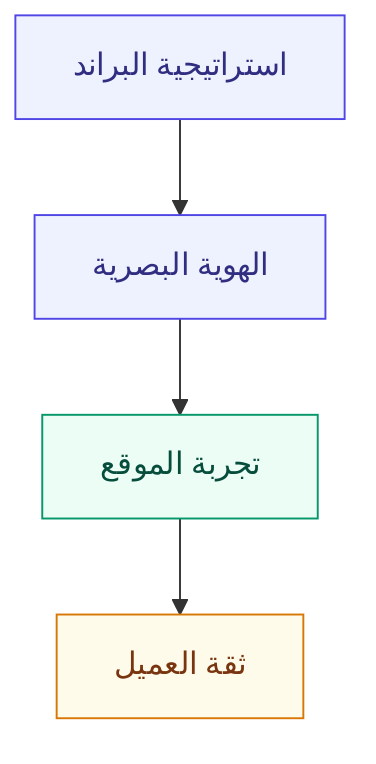
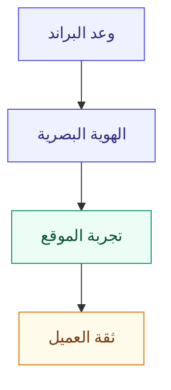

# الموقع ليس واجهة. بل هو الهوية وهي تعمل.

*لماذا تفشل معظم مواقع الشركات رغم جودة تصميمها، وكيف تتحول الواجهة إلى أصل تجاري عندما تُبنى من داخل الهوية لا فوقها.*

العميل لا يرى ملفات الهوية البصرية. ولا يقرأ دليل استخدام الشعار. ولا يهتم بنظام الألوان المكتوب في الدليل الإرشادي. المكان الوحيد الذي يعيش فيه البراند أمامه بشكل يومي هو الموقع. لهذا السبب، الموقع ليس مشروعاً منفصلاً عن الهوية، بل هو أول اختبار حقيقي لها.

- **4** — طبقات تتحول فيها الهوية إلى تجربة
- **70%** — من الانطباع يتكون قبل قراءة أول فقرة
- **1** — لغة بصرية يجب أن تحكم كل قرار

## الفجوة بين الهوية والواجهة

الهوية لا تنهار عندما يتغير اللوجو. تنهار عندما يتصرف الموقع وكأنه يتبع شركة أخرى.

*كل قرار داخل الموقع هو امتداد لقرار داخل الهوية. عندما تُبنى الواجهة بمعزل عن الهوية، تبدأ كل صفحة في تكوين شخصية مختلفة.*

| عنصر الهوية | كيف يجب أن يظهر داخل الموقع |
| --- | --- |
| شخصية البراند | أسلوب الحركة والتنقل |
| نبرة الصوت | العناوين وواجهة المحتوى |
| نظام الألوان | الأولوية البصرية وليس الزخرفة |
| الخطوط | الإيقاع وسهولة القراءة |
| الشبكة | الاتساق عبر جميع الصفحات |

## لماذا لا يكفي UI جميل؟

واجهة جميلة تستطيع جذب الانتباه. لكنها لا تستطيع بناء الثقة وحدها. الفرق بين الموقع الاحترافي والموقع المؤثر ليس عدد الحركات البصرية — بل عدد القرارات التي اتُّخذت انطلاقاً من الهوية.

| القرار | موقع مبني على الترند | موقع مبني على الهوية |
| --- | --- | --- |
| اختيار الألوان | لأنها جميلة | لأنها تعبّر عن البراند |
| المكونات | من مكتبة جاهزة | جزء من نظام تصميم |
| الحركة | لإبهار المستخدم | لتوجيه الانتباه |
| التخطيط | حسب القالب | حسب شخصية البراند |

## تجربة المستخدم تبدأ قبل أول نقرة

تجربة المستخدم لا تبدأ عند أول زر. بل تبدأ عندما يعرف العميل فور دخوله: هل هذه الشركة تشبه ما وعدتني به؟

*إذا اختلفت أي طبقة، تبدأ الثقة في التآكل — بهدوء، ودون أن يعرف العميل السبب.*

## عندما يعمل الـ UI ضد البراند

أكثر الأخطاء شيوعاً ليست أخطاء تصميم، بل أخطاء ترجمة: هوية هادئة وموقع مليء بالحركات، براند فاخر ومكونات تبدو رخيصة، شركة هندسية وموقع يشبه متجر ملابس. كل قرار صحيح بمفرده، لكن المجموعة ترسل رسالة مختلفة.

| ما يراه العميل | ما يظنه الفريق |
| --- | --- |
| الشركة غير متسقة | مجرد اختلاف بسيط |
| التجربة غير مريحة | تحسينات تصميم |
| الموقع لا يشبه البراند | صفحة واحدة فقط |

## من Figma إلى نظام هوية

Figma أداة، وليست نقطة البداية. قبل أول إطار تصميم يجب أن تكون هناك إجابات واضحة: كيف يبدو البراند؟ كيف يتحدث؟ كيف يتحرك؟ كيف يوجّه المستخدم؟ ماذا يجب أن يشعر به العميل بعد أول دقيقة؟ إذا لم تُحسم هذه الأسئلة، فكل شاشة ستكون اجتهاداً جديداً.

## النظام الذي يمنع الفوضى

الموقع القابل للتوسع لا يعتمد على مهارة المصمم، بل يعتمد على النظام الذي يعمل من خلاله.

| طبقة النظام | ما تحكمه |
| --- | --- |
| رموز التصميم | الألوان والمسافات |
| نظام الخطوط | التسلسل البصري |
| المكونات | إعادة الاستخدام |
| قواعد التفاعل | الحركة والاستجابة |
| قواعد المحتوى | أسلوب الكتابة |

كلما زاد التوثيق، قلّ الاجتهاد، وزاد الاتساق.

## قائمة فحص التنفيذ

1. هل يمكن معرفة شخصية البراند من أول خمس ثوانٍ؟
2. هل تعكس الحركة نفس شخصية الهوية؟
3. هل يمكن إضافة صفحة جديدة دون اختراع أسلوب جديد؟
4. هل يوجد نظام تصميم حقيقي أم مجرد مكتبة واجهات؟
5. هل يستطيع مصمم جديد العمل دون إعادة تفسير البراند؟

> الموقع ليس مجموعة صفحات، كما أن الهوية ليست لوجو. كلاهما نظام — لكن الفرق أن الهوية تصف الشخصية، أما الموقع فهو المكان الذي يختبر فيه العميل تلك الشخصية لأول مرة.
