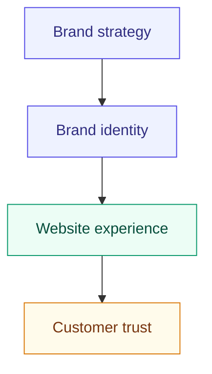
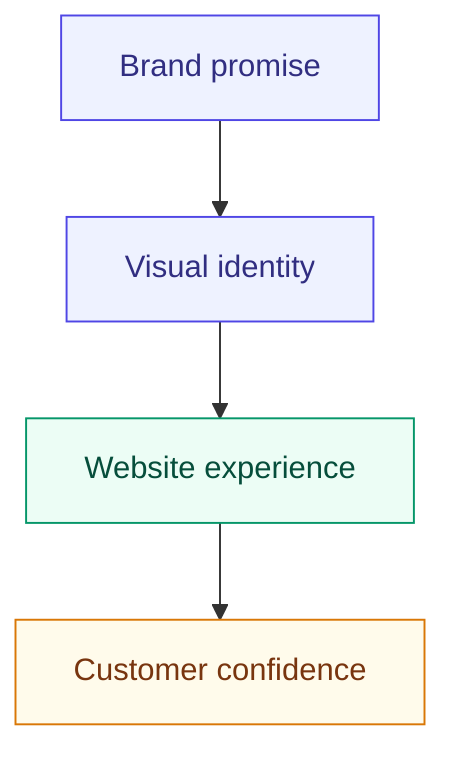

# The website is not an interface. It's the identity, operating.

*Why most websites fail despite great design, and how the interface becomes an asset built from identity, not on top.*

The client never sees the brand guidelines. Never reads the logo usage manual. Never thinks about the color system written into a PDF. The one place the brand lives in front of them, every day, is the website. That's why the website isn't a project separate from the identity — it's the identity's first real test.

- **4** — Layers where identity becomes experience
- **70%** — Of the impression forms before the first paragraph is read
- **1** — Visual language that should govern every decision

## The gap between identity and interface

Identity doesn't collapse when the logo changes. It collapses when the website starts acting like it belongs to a different company.

*Every decision inside the website is an extension of a decision inside the identity. Built apart from it, every page starts forming a different personality.*

| Identity element | How it should show up on the website |
| --- | --- |
| Brand personality | Motion and navigation style |
| Tone of voice | Headlines and content interface |
| Color system | Visual priority, not decoration |
| Typography | Rhythm and readability |
| Grid | Consistency across every page |

## Why beautiful UI isn't enough

A beautiful interface can capture attention. It can't build trust alone. The difference between a professional website and a persuasive one isn't the number of animations — it's the number of decisions made from the identity outward.

| Decision | Trend-built website | Identity-built website |
| --- | --- | --- |
| Color choice | Because it looks good | Because it expresses the brand |
| Components | Pulled from a library | Part of a design system |
| Motion | To impress the user | To direct attention |
| Layout | Whatever the template does | What the brand's personality does |

## UX starts before the first click

UX doesn't start at the first button. It starts the moment the customer arrives and asks: does this company look like what it promised me?

*If any layer drifts, trust erodes — quietly, and without the customer ever knowing why.*

## When the UI works against the brand

The most common mistakes aren't design mistakes. They're translation mistakes: a calm identity paired with a website full of motion, a premium brand paired with components that feel cheap, an engineering firm with a website that reads like a clothing store. Every decision is defensible alone — the combination sends a different message.

| What the customer sees | What the team assumes |
| --- | --- |
| The company feels inconsistent | Just a minor difference |
| The experience feels uncomfortable | Design refinements |
| The website doesn't feel like the brand | Just one page |

## From Figma to a brand system

Figma is a tool, not a starting point. Before the first frame exists, these need clear answers: What does the brand look like? How does it speak? How does it move? How does it guide the user? What should the customer feel after the first minute? Leave these unresolved, and every screen becomes a fresh improvisation.

## The system that prevents chaos

A website that scales doesn't depend on the designer's skill. It depends on the system it's built through.

| System layer | What it governs |
| --- | --- |
| Design tokens | Color and spacing |
| Typography system | Visual hierarchy |
| Components | Reuse |
| Interaction rules | Motion and response |
| Content rules | Writing style |

The more it's documented, the less is improvised — and the more consistent it stays.

## The execution checklist

1. Can the brand's personality be read within the first five seconds?
2. Does the motion reflect the same personality as the identity?
3. Can a new page be added without inventing a new style?
4. Is there a real design system, or just a UI kit?
5. Can a new designer work without reinterpreting the brand?

> A website isn't a set of pages, the same way an identity isn't a logo. Both are systems. But the difference is this: identity describes the character. The website is where the customer experiences that character for the first time.
